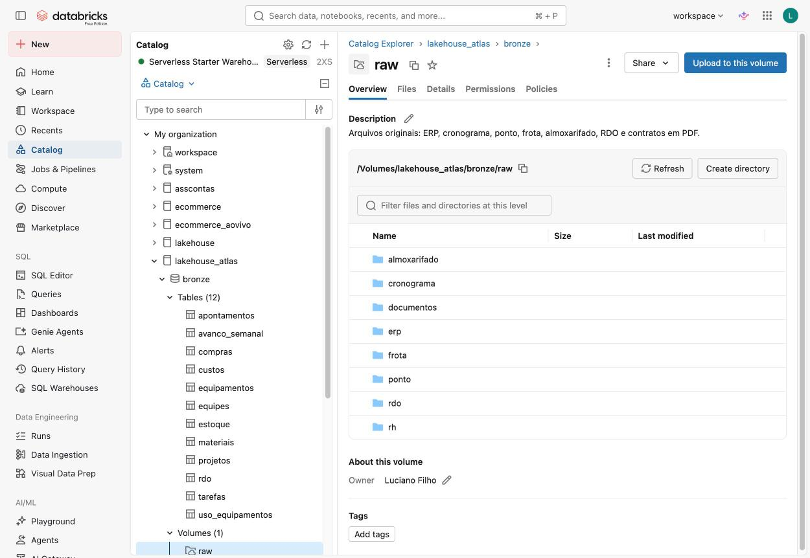
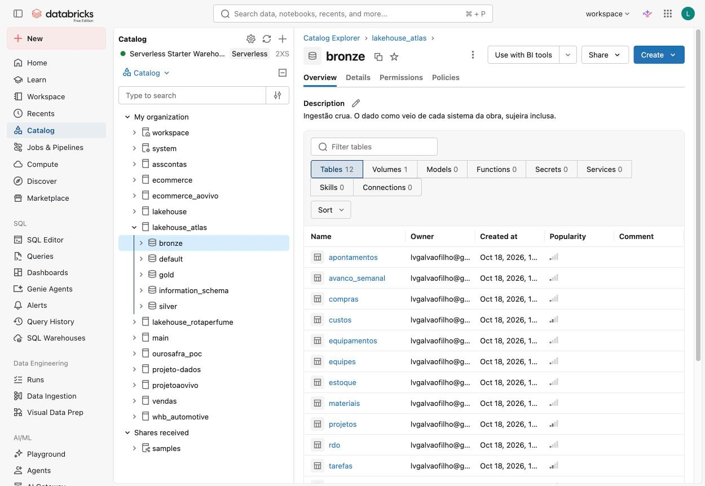
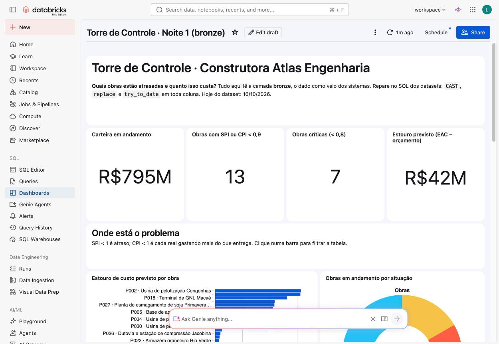

# 📊 Noite 1 · Analista | Imersão Databricks + Claude Code

> **Segunda, 19/10, 19h30** · 📺 gravação: _link após a live_
>
> **Pergunta da noite:** *"Quais obras estão atrasadas e quanto isso custa?"*
> **Você sai com:** o dado da Atlas no seu catálogo, SPI e CPI de cada obra em SQL, o estouro previsto em reais e o seu primeiro dashboard.
> **Conexão:** a sujeira que você achar hoje é o que a [noite 2](../aula-02-engenheiro) limpa, e o Genie que erra hoje é o que a noite 2 conserta.

Hoje é tudo **pelo navegador**. Nada para instalar.

---

## 🎯 Objetivos da noite

| # | Objetivo | Como você sabe que chegou lá |
|---|---|---|
| 1 | Montar o ambiente no Databricks Free Edition | catálogo `lakehouse_atlas` com `bronze`, `silver`, `gold` e o volume `raw` |
| 2 | Levar o dado dos 7 sistemas para o lakehouse | 12 tabelas na bronze, contagens iguais às do `99-verificacao.sql` |
| 3 | Encontrar a sujeira antes que ela vire decisão | os 8 achados do exemplo 03 |
| 4 | Calcular os KPIs de gestão de projetos em SQL | SPI e CPI das 36 obras em andamento (exemplo 05) |
| 5 | Traduzir KPI em dinheiro | R$ 41,9 mi de estouro previsto (exemplo 06) |
| 6 | Colocar a resposta numa tela e ver o Genie errar | dashboard publicado + 3 perguntas no Genie da bronze |

---

## 🛠️ Passo a passo

### 1. Crie a conta (5 min)

[databricks.com/learn/free-edition](https://www.databricks.com/learn/free-edition): sem cartão. Tudo roda em **serverless**: você não cria cluster.

### 2. Traga o repositório para dentro do Databricks (2 min)

**Workspace → Create → Git folder** → cole `https://github.com/lvgalvao/ImersaoControlTower` → **Create Git folder**.

O repositório inteiro aparece no seu workspace, inclusive o gerador de dados.

### 3. Gere os dados direto no volume (3 min)

Abra `aulas/aula-01-analista/00-carregar-dados` e clique **Run all**. O notebook:

1. roda o [`00-setup-catalogo.sql`](00-setup-catalogo.sql): catálogo, 3 schemas e o volume `bronze.raw`;
2. roda o [`material/gerar_dataset.py`](../../material/gerar_dataset.py) escrevendo em `/Volumes/lakehouse_atlas/bronze/raw/`;
3. roda o [`material/validar_padroes.py`](../../material/validar_padroes.py), que confere os 4 padrões da história. Termina com `TODOS OS PADRÕES OK`.



> **Prefere fazer à mão?** Rode `00-setup-catalogo.sql` no SQL Editor, gere os dados no seu computador
> (`python3 material/gerar_dataset.py --saida ./dados`) e suba cada pasta com **Upload to this volume**
> mantendo a estrutura `raw/<sistema>/<arquivo>.csv`.

### 4. Crie a bronze (2 min)

Abra [`01-ingestao-bronze.sql`](01-ingestao-bronze.sql) no **SQL Editor**, selecione tudo e rode. A última query mostra as 12 tabelas com as linhas de cada uma.



### 5. Confira (1 min)

Rode [`99-verificacao.sql`](99-verificacao.sql). As 18 linhas devem dar `ok`.

---

## 🗄️ O dado: Construtora Atlas Engenharia

EPC de médio porte: **40 obras** (36 em andamento), **R$ 903 mi** de carteira, mineração, óleo e gás e agroindústria em 9 estados. O "hoje" do dataset é **16/10/2026**.

```
Volume /Volumes/lakehouse_atlas/bronze/raw
├── erp/           projetos · custos · compras · materiais
├── cronograma/    tarefas · avanco_semanal
├── rh/            equipes
├── ponto/         apontamentos
├── frota/         equipamentos · uso_equipamentos
├── almoxarifado/  estoque
├── rdo/           rdo                (texto livre do engenheiro)
└── documentos/    rdo/*.pdf (135) · contratos/*.pdf (8)
```

| Tabela | Linhas | O que é | ⚠️ Cuidado |
|---|---:|---|---|
| `projetos` | 40 | o contrato de cada obra | `data_inicio` em 2 formatos; `uf` em caixa mista |
| `tarefas` | 8.000 | cronograma: baseline × realizado | 52 tarefas com `pct_concluido` > 100 |
| `avanco_semanal` | 55.703 | boletim de medição: % por tarefa por semana | |
| `custos` | 19.445 | lançamentos de custo real | 540 com vírgula decimal; 275 estornos negativos |
| `compras` | 13.304 | pedidos: prometido × entregue | o mesmo fornecedor escrito de 4 jeitos |
| `materiais` | 25 | cadastro e lead time contratado | |
| `estoque` | 40.094 | saldo semanal por obra e material | 61 saldos negativos (erro de inventário) |
| `equipes` | 123 | equipes de campo | 3 equipes duplicadas |
| `apontamentos` | 41.190 | horas disponíveis × apontadas | hora extra (> 100%) é legítima |
| `equipamentos` | 300 | guindastes, escavadeiras, munck… | |
| `uso_equipamentos` | 19.817 | horas operadas por semana | |
| `rdo` | 13.730 | relatório diário de obra | 80 vazios ou "N/A" |

> **Por que toda coluna é texto?** Se o Databricks adivinhasse os tipos, `14/03/2025` virava nulo e
> `12345,67` virava erro. A bronze preserva o problema para que ele seja resolvido, não escondido.

### Os 4 padrões que o dado esconde (a história da semana)

1. **8 obras com CPI caindo a partir do 9º mês**: aditivo de escopo não cobrado do cliente.
2. **Chuva no Pará de dezembro a março**: 3 obras (P003, P011, P024) com SPI do período abaixo de 0,55.
3. **Metalúrgica Norte Aço** entrega com lead time **41% acima** do prometido.
4. **Dois guindastes de 90 t parados em MG** (P007) enquanto o RDO da P011, no Pará, reclama de falta de guindaste.

Hoje você vê os sintomas (1 e parte do 2). As causas aparecem nas noites 2 e 4.

---

## 🎯 Os 6 exemplos

Cada exemplo usa o anterior. Rode no SQL Editor ou use os notebooks (veja abaixo).

| # | Arquivo | Conceito | Pergunta de negócio |
|---|---|---|---|
| 01 | [`exemplo-01-primeiro-select.sql`](exemplo-01-primeiro-select.sql) | `SELECT`, `LIMIT`, `COUNT` | Que obras a Atlas tem? Como é um RDO? |
| 02 | [`exemplo-02-order-by-e-distinct.sql`](exemplo-02-order-by-e-distinct.sql) | `ORDER BY`, `DISTINCT`, `CAST` | Quais os maiores contratos? Quanto vale a carteira? |
| 03 | [`exemplo-03-where-e-a-sujeira.sql`](exemplo-03-where-e-a-sujeira.sql) | `WHERE`, `LIKE`, `FILTER`, `HAVING` | **Dá para confiar nesse número?** |
| 04 | [`exemplo-04-group-by-custo-no-tempo.sql`](exemplo-04-group-by-custo-no-tempo.sql) | `GROUP BY`, `date_trunc`, `try_cast` | Quanto a Atlas gasta por mês? (a 1ª query **quebra de propósito**) |
| 05 | [`exemplo-05-join-spi-e-cpi.sql`](exemplo-05-join-spi-e-cpi.sql) | `JOIN`, `WITH`, `LEAST`, `datediff` | **Quais obras estão atrasadas ou estourando?** |
| 06 | [`exemplo-06-quanto-custa-o-atraso.sql`](exemplo-06-quanto-custa-o-atraso.sql) | CTE encadeada, janela `OVER()` | **Se nada mudar, quanto a Atlas perde?** |

Pelo terminal (opcional):

```bash
python3 scripts/run_sql.py aulas/aula-01-analista/exemplo-05-join-spi-e-cpi.sql --profile SEU-PERFIL
python3 scripts/run_sql.py aulas/aula-01-analista/exemplo-04-group-by-custo-no-tempo.sql --profile SEU-PERFIL --continuar
```

### Os KPIs, em uma linha cada

```
PV  valor planejado  = Σ valor_planejado × % do prazo baseline já decorrido   (quanto DEVIA estar pronto)
EV  valor agregado   = Σ valor_planejado × % concluído (corta em 100%)       (quanto ESTÁ pronto)
AC  custo real       = Σ custos (vírgula trocada por ponto)                   (quanto GASTAMOS)

SPI = EV / PV        < 1 é atraso          CPI = EV / AC        < 1 é estouro
EAC = orçamento / CPI                       estouro previsto = EAC − orçamento
margem projetada = (contrato − EAC) / contrato
atraso projetado (dias) = duração / SPI − duração

atenção: SPI ou CPI < 0,9          crítico: SPI ou CPI < 0,8
```

### 📓 Notebooks para dar (e acompanhar) a aula

[`notebooks/`](notebooks) tem os 6 exemplos em duas versões, geradas dos `.sql` por
[`scripts/gerar_notebooks.py`](../../scripts/gerar_notebooks.py):

- `notebooks/resolvidos/`: cada bloco é uma célula, com a query pronta;
- `notebooks/em-branco/`: a mesma explicação, com a célula vazia para escrever ao vivo.

No Git folder eles já aparecem. Para importar por fora:

```bash
python3 scripts/gerar_notebooks.py aulas/aula-01-analista --importar --profile SEU-PERFIL
```

---

## 🔢 O que deve aparecer na tela

Se o seu número divergir, o erro está na query, não no dado: a seed é fixa.

| Métrica | Valor |
|---|---|
| Carteira total · em andamento | R$ 903,0 mi · R$ 794,8 mi (36 obras) |
| Custo real total | R$ 572,85 mi (com `try_cast`: R$ 556,09 mi → **R$ 16,8 mi somem**) |
| Maior categoria de custo | mão de obra, R$ 202,5 mi |
| Obras em atenção · críticas | 13 · 7 |
| Piores SPI | P030 e P011, 0,78 |
| Piores CPI | P018, P021 e P005, 0,79 |
| Estouro previsto da carteira | **R$ 41,9 mi** (só obras que estouram) |
| Maior estouro | P002 e P021, R$ 6,3 mi cada |
| Maior atraso projetado | P011, +178 dias |

---

## 📊 O dashboard e o Genie

Roteiro completo, com o que perguntar e o que esperar: [`roteiro-genie-e-dashboard.md`](roteiro-genie-e-dashboard.md).



O dashboard é **código**: [`gerar_dashboard.py`](gerar_dashboard.py) escreve o
[`dashboard-bronze.lvdash.json`](dashboard-bronze.lvdash.json) e publica.

```bash
python3 aulas/aula-01-analista/gerar_dashboard.py --deploy --profile SEU-PERFIL
```

O Genie da noite 1 fica direto na bronze, **sem instrução nenhuma**, de propósito:
[`genie-bronze.json`](genie-bronze.json).

```bash
python3 scripts/genie.py publicar aulas/aula-01-analista/genie-bronze.json \
  --titulo "Torre de Controle · Noite 1 (bronze, sem curadoria)" --profile SEU-PERFIL
python3 scripts/genie.py perguntar "Torre de Controle · Noite 1 (bronze, sem curadoria)" \
  "Qual é o CPI de cada obra?" --profile SEU-PERFIL
```

---

## 🧯 Se der errado

| Sintoma | Causa | O que fazer |
|---|---|---|
| `00-carregar-dados` não acha `material/gerar_dataset.py` | o notebook foi importado solto, fora do Git folder | abra pelo Git folder (passo 2) |
| `PERMISSION_DENIED` ao criar catálogo | workspace que não é seu | use a sua conta Free Edition |
| `01-ingestao-bronze` dá `PATH_NOT_FOUND` | os arquivos não estão em `raw/<sistema>/` | rode o `00-carregar-dados` de novo |
| Tabela com 0 linhas | upload manual numa pasta errada | confira `/Volumes/lakehouse_atlas/bronze/raw/erp/projetos.csv` |
| `CAST_INVALID_INPUT` no exemplo 04 | **é de propósito** | é o ponto da aula: a vírgula decimal |
| SPI/CPI diferentes dos da tabela | `current_date()` no lugar de `DATE'2026-10-16'` | use a data fixa |
| Warehouse demora no primeiro comando | o serverless está ligando | espere uns 10 segundos |
| Dashboard em branco | o warehouse estava parado | atualize a página depois de 10 segundos |

---

## 🧭 Sem escrever código (trilha de gestão)

Para quem é de gestão, PMO ou financeiro e quer acompanhar sem SQL:

1. faça os passos 1 a 4 (só cliques e **Run all**);
2. abra o **dashboard** publicado e responda as 3 perguntas do slide olhando para ele;
3. use o **Genie** com as perguntas do roteiro e compare com a tabela "O que deve aparecer na tela";
4. no SQL Editor, use o **Genie Code** (o assistente do editor) e peça: *"calcule SPI e CPI por obra a partir de bronze.tarefas e bronze.custos, com hoje = 2026-10-16"*. Compare com o exemplo 05.

---

## 🗂️ Arquivos desta pasta

| Arquivo | Para que serve |
|---|---|
| `00-carregar-dados.py` | notebook: catálogo + gera os dados no volume + confere os padrões |
| `00-setup-catalogo.sql` | catálogo, schemas e volume (também roda no SQL Editor) |
| `01-ingestao-bronze.sql` | os 12 CSVs viram tabelas Delta, tudo texto |
| `exemplo-01..06-*.sql` | os 6 exemplos da noite |
| `99-verificacao.sql` | esperado × obtido, 18 checagens |
| `notebooks/` | os exemplos em notebook, resolvidos e em branco |
| `gerar_dashboard.py` · `dashboard-bronze.lvdash.json` | o dashboard como código |
| `genie-bronze.json` | o Genie sem curadoria (para errar) |
| `roteiro-genie-e-dashboard.md` | o bloco sem código da aula |
| Slides | [`slides/aula-01.html`](../../slides/aula-01.html) (abra no navegador, ← → navega, F tela cheia) |

---

## ➡️ Amanhã

Você limpou a sujeira **dentro de cada query**: `replace`, `upper(trim())`, `LEAST(…, 100)`, `try_to_date`.
Dá certo uma vez. Na terceira query, alguém esquece, e o número muda.

Amanhã a limpeza vira **pipeline**: escrito com Claude Code, testado, agendado, com os KPIs definidos uma
vez só, e a IA lendo os 13,7 mil RDOs para achar a causa do atraso. → [aula-02](../aula-02-engenheiro)

**Lição de casa:** instale a [CLI do Databricks](https://docs.databricks.com/dev-tools/cli/install.html)
e o [Claude Code](https://claude.com/claude-code), e rode `databricks auth login`.
