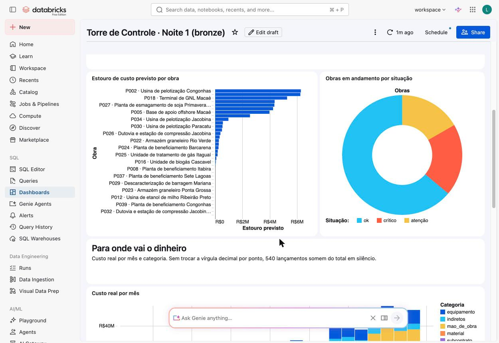
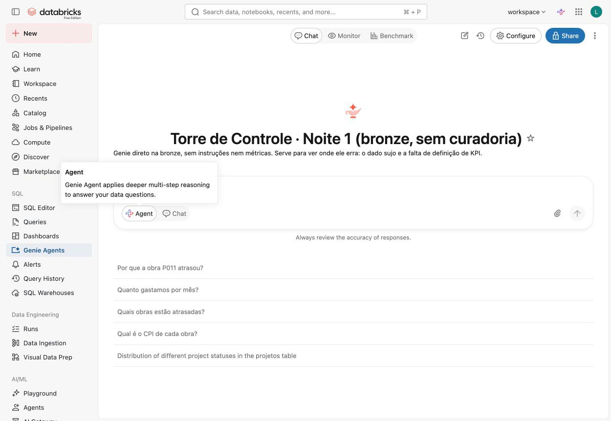

# Roteiro · Dashboard e Genie (bloco final da noite 1, ~15 min)

O ponto do bloco: **a resposta vira tela**, e o Genie, que parece mágica, **erra com confiança**
quando o dado está sujo e o KPI não está definido. Isso prepara a noite 2.

## 1. O dashboard (7 min)

Abra **Dashboards → Torre de Controle · Noite 1 (bronze)** (ou rode
`python3 aulas/aula-01-analista/gerar_dashboard.py --deploy --profile SEU-PERFIL`).

O que mostrar, nesta ordem:

1. **Os 4 números do topo**: carteira de R$ 795 mi em andamento, 13 obras em risco, 7 críticas, **R$ 42 mi** de estouro previsto.
   São os mesmos números do exemplo 06. O dashboard não inventa nada: é o mesmo SQL.
2. **Clique numa barra** do "Estouro previsto por obra": a tabela embaixo filtra. Os widgets compartilham o dataset.
3. **Abra o dataset** (Edit draft → Data): o SQL está cheio de `CAST`, `replace`, `try_to_date`.
   Pergunte: *"e se amanhã alguém fizer outro dashboard e esquecer o `replace`?"* São R$ 16,8 mi de diferença.
4. **Mostre que é código**: `dashboard-bronze.lvdash.json` no repositório. Versionado, revisável, recriável.

## 2. O Genie (8 min)

Abra **Genie Agents → Torre de Controle · Noite 1 (bronze, sem curadoria)**.
Ele tem só 4 tabelas da bronze e **nenhuma instrução**.

Faça as perguntas nesta ordem. Os resultados abaixo foram observados no ensaio de 18/10.

| # | Pergunta | O que o Genie fez | O que comentar |
|---|---|---|---|
| 1 | *Quanto gastamos no total?* | `SUM(try_cast(REPLACE(valor_real, ',', '.')))` → **R$ 572.849.442,19** ✅ | Ele leu os dados e tratou a vírgula. Impressiona. |
| 2 | *Qual é o CPI de cada obra?* | JOIN de `tarefas` com `custos` por `projeto_id` (multiplica as linhas) e CPI = planejado ÷ real → **"CPI entre 2,10 e 7,01"** ❌ | CPI de 7 não existe. Ele **não sabe** o que é CPI na Atlas e o JOIN explodiu. Fala com total confiança. |
| 3 | *Por que a obra P011 atrasou?* | listou tarefas com `fim_real > fim_baseline` ❌ | A causa (chuva e **falta de guindaste**) está no texto do RDO. Ele não leu, porque texto livre não é coluna. |
| 4 | *Quais obras estão atrasadas?* | varia: costuma comparar datas de tarefa, sem SPI | "Atrasada" não está definido em lugar nenhum. |

> O Genie pode responder diferente a cada execução. Se ele acertar o CPI, ótimo: pergunte
> *"e qual a regra de crítico?"* e mostre que ele não conhece o corte de 0,8 da Atlas.

**A frase de fechamento:** *"O Genie é tão bom quanto o dado e as definições que você dá a ele. Amanhã
a gente limpa o dado, define cada KPI uma vez só (metric views) e ensina o Genie. Na noite 4, ele
responde a pergunta 3 citando o RDO."*

## Perguntas de reserva (se sobrar tempo)

- *Qual fornecedor mais atrasa entregas?* → ele vê 4 "fornecedores" diferentes para a Norte Aço.
- *Quantas obras temos em Minas Gerais?* → `uf = 'MG'` perde "mg" e " MG ".
