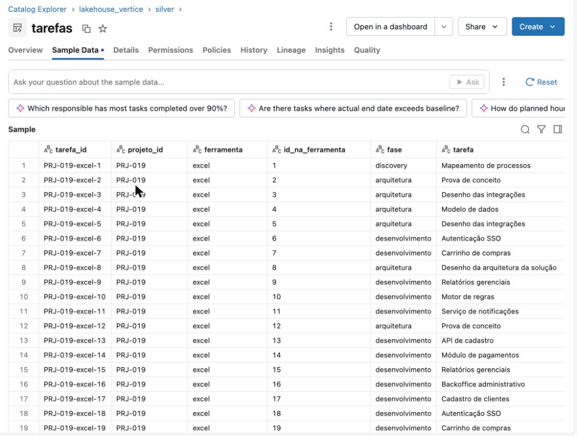
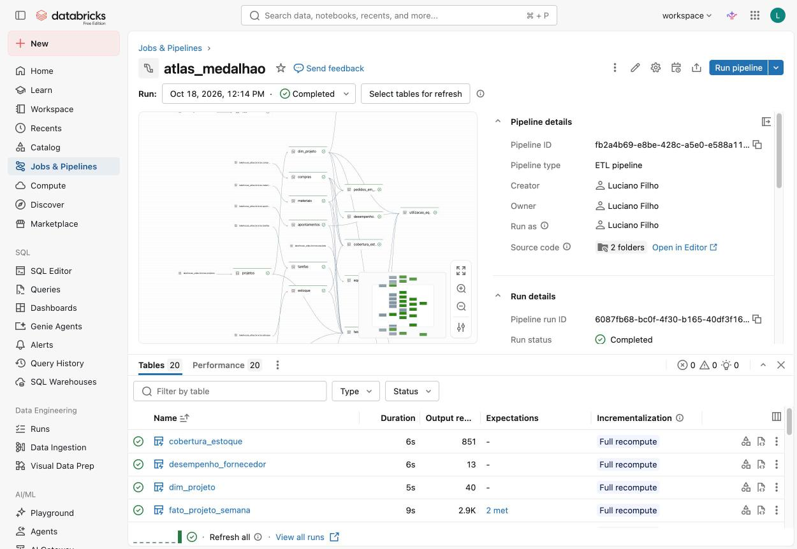
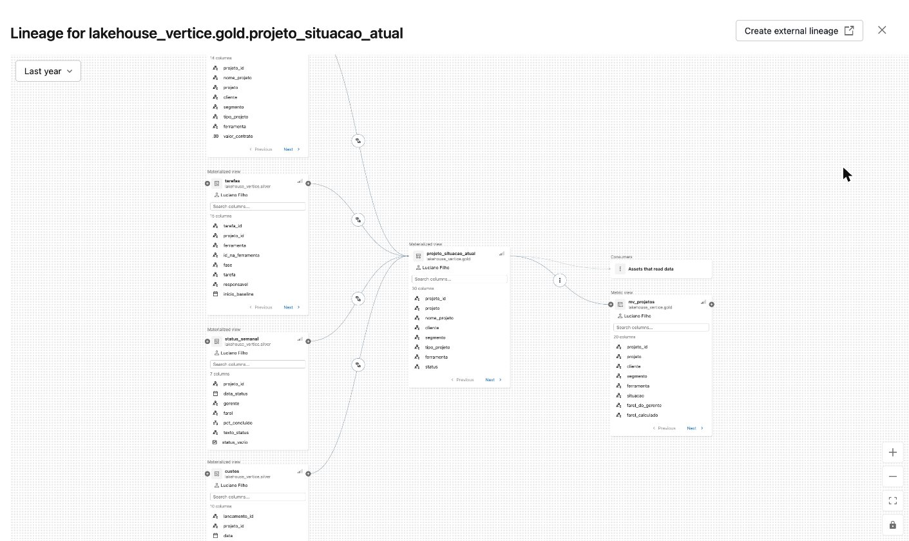
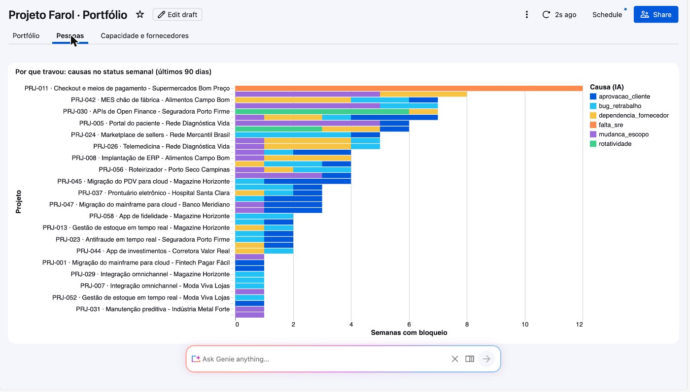
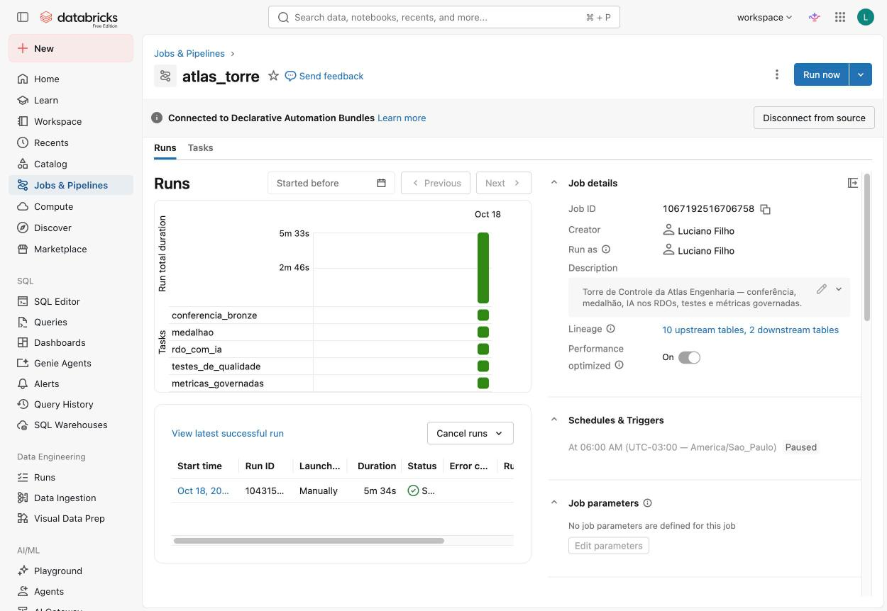
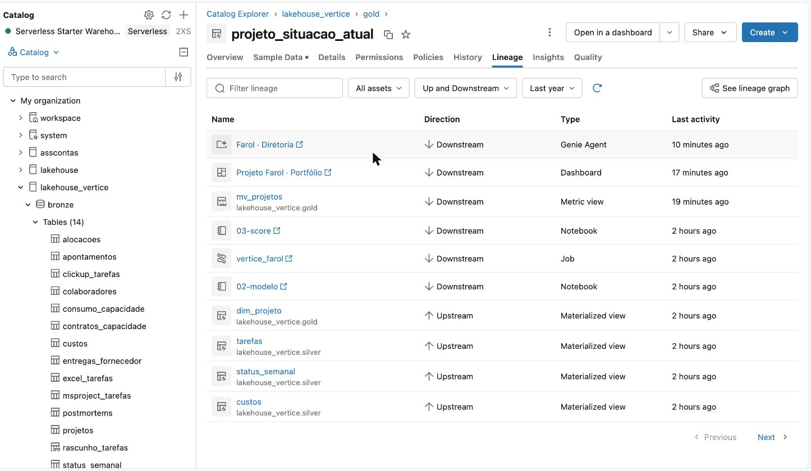

# 🛠️ Noite 2: Engenheiro de Dados | Imersão Jornada de Dados

**Terça, 20/10/2026, 19h30.**

**Ao fim desta noite você terá** a Torre de Controle da Vértice rodando sozinha: Excel, ClickUp e
MS Project juntos numa tabela só, os KPIs de prazo e custo calculados com teste, a causa de cada
atraso tirada do texto do status por IA e a fórmula de cada KPI num lugar só. Tudo como código: um
aquecimento em Python (uma API nova na bronze) e **cinco prompts no Claude Code**, num job que roda toda segunda às 6h.

> **Mudou em 20/10:** o dashboard e o Genie (o antigo prompt 6) passaram para a [noite 3](../aula-03-cientista),
> depois do modelo. Hoje a noite fecha na modelagem: silver, gold e testes.

**Por que isso responde ao dono:** ontem o Genie errou as quatro perguntas dele ("nenhum atraso
custa nada"), porque olhava dado sujo e espalhado. Hoje a gente constrói o dado limpo e testado que faz ele acertar amanhã.

> **O caso:** Vértice Tecnologia, 60 projetos de clientes, controlados em Excel (20), ClickUp (25) e
> MS Project (15). Você é o único profissional de dados: hoje, o engenheiro.
> **Pergunta da noite:** *"Como as três ferramentas viram uma — e isso roda sozinho, certo?"*
> **Conexão:** a gold de hoje é o que a [noite 3](../aula-03-cientista) usa para prever qual
> projeto vai estourar em 30 dias.

---

## 🎯 As perguntas do dono e onde a noite 2 responde

| Pergunta do dono | Onde a resposta nasce hoje | O que aparece |
|---|---|---|
| 1. Quais projetos estão atrasados, e de quais clientes? | prompt 3 (gold) | 7 críticos, 10 em atenção, 4 "melancias" |
| 2. Quanto esse atraso vai custar? | prompt 3 (gold) + prompt 5 (métricas) | R$ 6,47 mi de estouro previsto |
| 3. Tenho gente parada enquanto outro projeto pede gente? | prompt 3 (timesheet) + prompt 4 (IA no status) | 2 SREs a ~5% no PRJ-007; o PRJ-011 pede SRE há 12 semanas |
| 4. O que vai dar errado no próximo mês? | silver (fornecedores); no Genie, amanhã | 5 entregas da CodeForge atrasadas e o change freeze da Black Friday (01/11 a 10/01) nos projetos de e-commerce |

A pergunta 4 ganha um modelo de previsão amanhã (`gold.score_estouro_30d`, noite 3). Hoje ela já tem os sinais.

---

## 🔁 Antes × depois: o que "integrar" quer dizer

**Ontem (bronze):** a planilha do gerente, do jeito que chegou. Data como número de série do Excel
(`45700`) misturada com `13/03/2025`, fase em maiúscula, cada planilha com as suas colunas.


*Repare na coluna `inicio_previsto`: metade é número (`45700`), metade é data escrita. E isso é só o Excel.*

**Hoje, depois do prompt 2 (silver):** as três ferramentas com as **mesmas colunas**, uma tarefa por
linha, com o projeto (`PRJ-019`) e a ferramenta de origem ao lado.


*Repare no `tarefa_id` (projeto-ferramenta-número) e nas colunas `projeto_id` e `ferramenta`: é assim que 4.917 tarefas de 60 arquivos viram uma tabela.*

---

## 📖 As palavras da noite (em uma frase)

| Termo | O que é |
|---|---|
| **Bronze / silver / gold** | As três camadas do dado: bronze é como chegou (noite 1), silver é limpo e integrado, gold é pronto para responder ao negócio. |
| **Bundle** | O projeto inteiro (job, pipeline, dashboard, Genie) descrito em arquivos, num `databricks.yml`. Um `bundle deploy` sobe tudo. |
| **Deploy** | Mandar o que está no seu computador para o workspace do Databricks. |
| **Pipeline (Lakeflow)** | Um conjunto de tabelas que você só *declara* ("a silver.tarefas é isto"); o Databricks descobre a ordem e roda. |
| **`EXPECT`** | Uma regra de qualidade escrita na tabela. Se o dado quebrar a regra, o pipeline para em vez de gravar errado. |
| **Job** | A lista de tarefas que roda numa ordem e num horário (aqui: toda segunda às 6h). |
| **SPI / CPI** | Índices de prazo e de custo. Abaixo de 1 = atrasado / gastando mais que o previsto. |
| **`ai_classify` / `ai_extract`** | Funções de IA dentro do SQL. A primeira põe o texto numa categoria; a segunda tira campos dele (quem destrava, quantos dias). |
| **Metric view** | Onde a **fórmula** de um KPI mora uma vez só. Dashboard, Genie e SQL usam a mesma. |
| **Genie curado** | O Genie com instruções de negócio, exemplos e tabelas certas. É o que faltou ontem. |
| **Benchmark** | 20 perguntas com a resposta certa. É o teste do Genie. |

---

## 🏗️ O desenho do que você vai construir

```
 bronze (noite 1)  ──►  pipeline vertice_medalhao  ──►  IA no texto  ──►  metric view  ──►  dashboard + Genie
 9 tabelas:             silver (7): limpa e junta        status semanal     mv_projetos        "Projeto Farol · Portfólio"
 CSV, Excel,            as 3 ferramentas                                                      "Farol · Diretoria"
 JSON, XML              gold (3): os KPIs

 └──────────────────────── tudo dentro do job vertice_farol, toda segunda às 6h ────────────────────────┘
```

<details>
<summary>O job tarefa por tarefa e o pipeline por dentro (para quem quer o detalhe)</summary>

```
                       job vertice_farol  (toda segunda às 6h, serverless)
 ┌────────────────────────────────────────────────────────────────────────────────────┐
 │                                                                                    │
 │  conferencia_bronze ──► medalhao ──┬──► testes_de_qualidade ──┐                    │
 │  (sql_task)             (pipeline) │    (sql_task, 10 testes) │                    │
 │  9 contagens            silver ×7  └──► status_com_ia ────────┴──► metricas_       │
 │  ou raise_error         gold ×3         (regra + ai_classify       governadas      │
 │                         EXPECT           + ai_extract, MERGE)      (mv_projetos)   │
 └────────────────────────────────────────────────────────────────────────────────────┘
        ▲                                                                  │
   bronze (noite 1)                 dashboard_portfolio ◄── gold + mv_projetos ──► genie_farol
   9 tabelas: CSV, Excel, JSON, XML  (bundle, 3 páginas)                          (bundle, 20 perguntas)
```

```
bronze.projetos ─────────► silver.projetos (o de-para) ──┐
bronze.excel_tarefas ────► tarefas_excel ─────┐          │
bronze.clickup_tarefas ──► tarefas_clickup ───┼─► silver.tarefas ─┬─► gold.projeto_situacao_atual (hoje)
bronze.msproject_tarefas ► tarefas_msproject ─┘   (UNION ALL)     │
bronze.status_semanal ───► silver.status_semanal ─────────────────┼─► gold.fato_projeto_semana (histórico)
bronze.custos ───────────► silver.custos ─────────────────────────┤
bronze.apontamentos ─────► silver.apontamentos ──┐                │
bronze.colaboradores ────► silver.colaboradores ─┴────────────────┴─► gold.utilizacao_pessoa_semana
bronze.entregas_forn. ───► silver.entregas_fornecedor ──────────────► (lida direto pelo dashboard e pelo Genie)
                           silver.status_semanal ──(job: status_com_ia)───► gold.status_estruturado
                           gold.projeto_situacao_atual ──(job: metricas_governadas)──► gold.mv_projetos
```

</details>

---

## 🚀 Antes do prompt 0: o passo a passo, do zero

A noite 1 foi toda pelo navegador. A noite 2 precisa de **terminal** (a tela onde se digitam
comandos). Siga na ordem; cada passo termina com um comando que **confere** se deu certo.

> 🎥 **Vídeos de referência**
> - Instalar o Antigravity e o GitHub, passo a passo: <https://www.youtube.com/watch?v=8mcBuO6wo4U&t=3s>
> - Databricks + IA, em detalhes: <https://www.youtube.com/watch?v=0l-DZkniRSg&t=1122s>

**Passo 1 · O editor: Antigravity**

Baixe e instale em <https://antigravity.google>. É o editor onde você abre a pasta do projeto e usa o
terminal (menu **Terminal › New Terminal**). Qualquer editor com terminal serve (VS Code, Cursor).

**Passo 2 · Git e GitHub CLI**

```bash
# macOS
brew install git gh
# Windows (PowerShell)
winget install Git.Git GitHub.cli

git --version          # git version 2.x
gh auth login          # GitHub.com › HTTPS › Login with a web browser
gh auth status         # ✓ Logged in to github.com
```

Sem conta no GitHub? Crie em <https://github.com/signup> antes do `gh auth login`.

**Passo 3 · O seu repositório, do zero**

Não tem `git clone`: o projeto nasce vazio, na sua conta. No fim da semana ele é o seu portfólio.

```bash
mkdir -p ~/projetos/projeto-farol && cd ~/projetos/projeto-farol
git init -b main

# o contexto do projeto: o negócio, as 18 sujeiras do dado e as armadilhas do Free Edition.
# Um CLAUDE.md na raiz é lido sozinho pelo Claude Code, antes de cada prompt.
curl -fsSL -o CLAUDE.md https://raw.githubusercontent.com/lvgalvao/ImersaoControlTower/main/aulas/aula-02-engenheiro/prd/CLAUDE.md

# o script que roda SQL pela API (a metric view do prompt 5 precisa dele)
mkdir -p scripts && curl -fsSL -o scripts/run_sql.py https://raw.githubusercontent.com/lvgalvao/ImersaoControlTower/main/scripts/run_sql.py

gh repo create projeto-farol --public --source=. --remote=origin
ls                     # CLAUDE.md  scripts
```

No Antigravity: **File › Open Folder** e escolha `~/projetos/projeto-farol`. Daqui em diante, todo
comando roda no terminal do Antigravity, **na raiz desta pasta**. O material do curso (prompts,
gabarito, slides) fica no GitHub: <https://github.com/lvgalvao/ImersaoControlTower>.

**Passo 4 · Python**

```bash
python3 --version      # 3.10 a 3.12. Evite o 3.13 com as bibliotecas do Databricks
pip3 install requests  # a biblioteca do prompt 0
```

**Passo 5 · A CLI do Databricks** (o programa que conversa com o seu workspace)

```bash
# macOS
brew tap databricks/tap && brew install databricks
# Windows (PowerShell)
winget install Databricks.DatabricksCLI
# Linux
curl -fsSL https://raw.githubusercontent.com/databricks/setup-cli/main/install.sh | sh

databricks -v          # Databricks CLI v0.250 ou mais nova
```

**Passo 6 · O login no workspace (o passo em que todo mundo tropeça)**

```bash
databricks auth login --host https://SEU-WORKSPACE.cloud.databricks.com --profile vertice
# abre o navegador: entre na sua conta do Free Edition e autorize
databricks auth profiles
# vertice   https://dbc-xxxx.cloud.databricks.com   YES
```

O endereço do workspace é o da barra do navegador quando você está no Databricks (até o `.com`).
O *profile* (`vertice`) é o apelido do login: **todo comando daqui em diante leva `--profile vertice`**.
Viu `refresh token is invalid` ou `Valid: NO`? Rode o `auth login` de novo.

**Passo 7 · Confira a bronze da noite 1**

```bash
databricks experimental aitools tools query "SHOW TABLES IN lakehouse_vertice.bronze" --profile vertice
# apontamentos, clickup_tarefas, colaboradores, custos, entregas_fornecedor,
# excel_tarefas, msproject_tarefas, projetos, status_semanal (+ rascunho_tarefas, do exemplo 05)
```

Falta o `rascunho_tarefas`? Rode o bloco 3 do exemplo 05 no SQL Editor
([`exemplo-01-a-05-sql-na-bronze.sql`](../aula-01-analista/exemplo-01-a-05-sql-na-bronze.sql)). Faltam tabelas?
Faça a noite 1 primeiro (`00-carregar-dados` + `01-ingestao-bronze`).

**Passo 8 · O Claude Code**

```bash
# macOS / Linux
curl -fsSL https://claude.ai/install.sh | bash
# Windows (PowerShell)
irm https://claude.ai/install.ps1 | iex

claude --version
claude                 # na RAIZ do repositório. Na primeira vez, faz o login
```

Instale as **skills oficiais do Databricks** no projeto (o "manual" que o Claude Code lê sobre bundles,
pipelines, metric views e funções de IA):

```bash
databricks aitools install --agents claude-code --scope project --skills-only --experimental
ls .claude/skills      # databricks-core, databricks-dabs, databricks-pipelines...
```

**Passo 9 · As travas, antes de dar acesso ao workspace**

Crie `.claude/settings.json` proibindo o que não tem volta:

```bash
cat > .claude/settings.json <<'JSON'
{
  "permissions": {
    "deny": ["Bash(databricks bundle destroy*)", "Bash(databricks bundle deploy --target prod*)",
             "Bash(git push --force*)", "Bash(rm -rf*)"]
  }
}
JSON
```

**Passo 10 · O bundle: o que é e quem cria**

O bundle é o projeto inteiro (job, pipeline, SQL) descrito em arquivos, com um `databricks.yml` na
raiz. A CLI tem um gerador de esqueleto:

```bash
databricks bundle init                 # pergunta o template: default-python, default-sql, default-minimal...
```

**Hoje você não roda o `bundle init` à mão.** Os templates criam o target com `mode: development`, que
prefixa todos os nomes com `[dev seu_nome]` e quebra os caminhos da noite. Quem cria o bundle é o
**prompt 1**, na raiz do seu repositório (o `databricks.yml` ao lado do `CLAUDE.md`), já do jeito
certo. Depois, a cada prompt, o ciclo é sempre o mesmo, na raiz:

```bash
databricks bundle validate --profile vertice          # confere o YAML antes de subir
databricks bundle deploy   --profile vertice          # sobe o código para o workspace
databricks bundle run vertice_farol --profile vertice # roda o job
```

(O Claude Code roda esses comandos para você e pede licença antes de cada um: leia e aprove.)

**Passo 11 · Ao fim de cada prompt, salve no GitHub**

```bash
git add . && git commit -m "prompt 1: bundle e conferência da bronze" && git push -u origin main
```

Os prompts dizem "na raiz deste repositório": é a sua pasta `projeto-farol`. Se um prompt não
entregar, o **gabarito** está em
<https://github.com/lvgalvao/ImersaoControlTower/tree/main/aulas/aula-02-engenheiro/vertice>: compare o arquivo.

Pronto. Agora é prompt a prompt.

---

## 🧾 Os prompts, um por um

Cada prompt termina com um **deploy**. Enquanto o Claude Code trabalha, o professor explica o
conceito: o tempo de espera vira aula. O texto exato de cada prompt está no arquivo (copie e cole);
a sequência inteira está em [`PROMPTS.md`](../../PROMPTS.md). Antes de cada um, o Claude Code lê
[`prd/CLAUDE.md`](prd/CLAUDE.md): o negócio, as 18 sujeiras do dado, a arquitetura e as armadilhas
do Free Edition já medidas.

| # | Arquivo | O que entrega | Tempo medido |
|---|---|---|---|
| 0 | [`prompt-00-api.md`](prd/prompt-00-api.md) | aquecimento: API em Python → `bronze.feriados` | ~1 min |
| 1 | [`prompt-01-bundle.md`](prd/prompt-01-bundle.md) | bundle + job + conferência da bronze | ~40 s |
| 2 | [`prompt-02-silver.md`](prd/prompt-02-silver.md) | pipeline, `silver.tarefas` + 6 tabelas | ~2 min |
| 3 | [`prompt-03-gold.md`](prd/prompt-03-gold.md) | 3 tabelas gold (fotografia, filme, pessoas) + 10 testes | ~3 min |
| 4 | [`prompt-04-texto-com-ia.md`](prd/prompt-04-texto-com-ia.md) | `status_estruturado` (ai_classify + ai_extract) | ~2 min |
| 5 | [`prompt-05-metricas.md`](prd/prompt-05-metricas.md) | a metric view `mv_projetos` | ~10 s |

Se um prompt não entregar, o **gabarito** está em [`vertice/`](vertice): compare o arquivo.

### Prompt 0 · Aquecimento: uma fonte nova, por API

**O que você pede:** um script Python que busca os feriados de 2026 na BrasilAPI, salva o JSON, sobe
o arquivo para o volume (`/Volumes/lakehouse_vertice/bronze/raw/feriados/`) e cria a
`bronze.feriados` com `read_files`.

**A ideia:** na empresa, o dado não chega pronto. Quando a fonte não tem conector, entra o Python. E o
caminho é o mesmo da noite 1: **extrair** (requests), **pousar** (o arquivo no volume, do jeito que
veio) e **carregar** (`read_files`).

**O que conferir:** 14 feriados no ano; em novembro, 2 em dia útil (02/11 e 20/11; o 15/11 é
domingo), bem no começo do freeze da Black Friday. Travou? `curl -fsSLO https://raw.githubusercontent.com/lvgalvao/ImersaoControlTower/main/aulas/aula-02-engenheiro/00-buscar-feriados.py && python3 00-buscar-feriados.py --profile vertice`.

### Prompt 1 · O projeto vira código

**O que você pede:** criar o bundle `vertice` na raiz do seu repositório, com o job `vertice_farol` e uma
primeira tarefa que só **confere** a bronze: as 9 tabelas da noite 1 têm o número de linhas
esperado? Se não, o job para com uma mensagem dizendo o que fazer.

**A ideia:** sexta que vem os gerentes atualizam tudo de novo. Quem roda? Na mão? Com o bundle, o
projeto fica no Git (tem histórico e revisão) e o `bundle deploy` sobe tudo igual na máquina de
qualquer pessoa. E antes de calcular qualquer KPI, a gente confere se o dado chegou inteiro: melhor
o dashboard com o dado da semana passada do que com meio dado.

**O que conferir:** abra o job no workspace. Uma caixa só, verde, com 9 linhas `ok`. Esse desenho
vai crescer a noite inteira.


*O deploy copia o seu bundle para `Workspace › Users › você › .bundle › vertice › dev › files`. Repare no caminho no topo: é o mesmo `src/` da sua pasta. (No print, a pasta `ml` já é da noite 3.)*

> **Teste se a conferência tem dente:** troque um número esperado (por exemplo `projetos 61`), faça
> deploy e rode. O job falha com a sua mensagem. Desfaça e rode de novo.

### Prompt 2 · As três ferramentas viram uma

> **A entrega mais importante da noite. Não corte.**

**O que você pede:** um pipeline declarativo (`vertice_medalhao`) que lê as três ferramentas, limpa
cada uma do seu jeito e empilha todas na `silver.tarefas`, com as **mesmas colunas**.

**A ideia, em três frases:**

- **A integração é um contrato de colunas.** Excel, ClickUp e Project viram, cada um, uma visão com
  as mesmas colunas (projeto, fase, tarefa, datas, %, horas). Depois é só empilhar. A ferramenta
  nova que aparecer amanhã é só mais uma visão.
- **O de-para é dado, não código.** Quem diz que a lista `901200095028` do ClickUp é o PRJ-012 é o
  cadastro do PMO. Se o código falta, o pipeline casa pelo nome do arquivo ou da lista.
- **`EXPECT` é contrato.** Se uma tarefa ficar sem projeto, ou um % passar de 100, o pipeline para
  em vez de gravar errado.

**Por que o rascunho de ontem não serve como produto:** ele funciona, mas é frágil. Esqueça a linha
de `TOTAL` da planilha e as horas do Excel dobram. Esqueça as tarefas-resumo do Project e as horas
dobram de novo. Use `try_cast` no custo com vírgula decimal e **R$ 5,4 milhões somem sem erro**
(187,94 em vez de 193,35). O prompt 2 escreve cada uma dessas regras uma vez, com teste.

**O que conferir:**

```sql
SELECT ferramenta, COUNT(DISTINCT projeto_id) AS projetos, COUNT(*) AS tarefas
FROM lakehouse_vertice.silver.tarefas GROUP BY 1;
-- excel 20 · 1.643 | clickup 25 · 2.119 | msproject 15 · 1.155

SELECT ROUND(SUM(valor) / 1e6, 2) FROM lakehouse_vertice.silver.custos;   -- 193,35: o custo não mudou
```


*O grafo que o Lakeflow desenhou sozinho: `tarefas_excel`, `tarefas_clickup` e `tarefas_msproject` desaguando em `tarefas`. Embaixo, cada tabela com a duração e as linhas gravadas. (O print é do ensaio, antes da simplificação: ainda aparecem tabelas que saíram, como `dim_projeto`.) Clique numa tabela e abra **Data quality** para ver os `EXPECT`.*


*Em **Jobs & Pipelines**, busque `vertice`: o job `vertice_farol` (agendamento **Paused**, de propósito no ambiente de desenvolvimento) e o pipeline `vertice_medalhao`. As bolinhas vermelhas são execuções que falharam no ensaio: faz parte.*

> *"Juntei vinte planilhas, vinte e cinco listas do ClickUp e quinze cronogramas do Project numa
> tabela só. Nenhuma tarefa ficou sem projeto, e o custo total não mudou um centavo. É esse o teste."*

### Prompt 3 · A gold responde às perguntas do dono

**O que você pede:** no mesmo pipeline, três tabelas gold, uma por pergunta:

- `projeto_situacao_atual`: a **fotografia de hoje** (16/10/2026), uma linha por projeto, com o
  cadastro (cliente, segmento, tipo, ferramenta, gerente, contrato, prazo), SPI, CPI, estouro
  previsto e a situação (crítico, atenção, ok).
- `fato_projeto_semana`: o **filme**, projeto × semana, para ver quem está piorando.
- `utilizacao_pessoa_semana`: as **pessoas**, do timesheet, para achar quem está parado.

E uma tarefa de **10 testes** que quebra o job se algum número não fechar. Fornecedor não ganha
tabela gold: a `silver.entregas_fornecedor` já tem o nome normalizado e responde direto.

**A pergunta para a turma antes do prompt:** de onde vem o histórico? Excel, ClickUp e Project só
guardam o % de *hoje*. O único lugar com o % de cada semana é o **status semanal** que o gerente
publica toda sexta. Por isso o filme usa o status e a fotografia usa as tarefas.

**O que conferir:**

```sql
SELECT situacao, COUNT(*) AS projetos, COUNT_IF(melancia) AS melancias
FROM lakehouse_vertice.gold.projeto_situacao_atual GROUP BY situacao;
-- crítico 7 · atenção 10 (4 melancias) · ok 24 · concluído 19
```

O estouro previsto dos projetos em andamento dá **R$ 6,47 mi**, o mesmo do rascunho de ontem. E as
duas SREs paradas aparecem no timesheet: COL0017 e COL0018, a ~5% no PRJ-007, que ainda está no
desenho. É meia pergunta 3 do dono respondida (a outra metade vem no prompt 4).


*A gold no Catalog Explorer, com a descrição do schema. As tabelas desta noite são `fato_projeto_semana`, `projeto_situacao_atual`, `utilizacao_pessoa_semana`, `status_estruturado` e a metric view `mv_projetos`. (O print é do ensaio, antes da simplificação: ainda mostra tabelas que saíram, como `dim_projeto` e `cobertura_capacidade`, e as das noites 3 e 4.)*


*Aba **Lineage** › **See lineage graph**: a `projeto_situacao_atual` nasce de quatro tabelas silver (`projetos`, `tarefas`, `status_semanal`, `custos`) e alimenta a `mv_projetos`. (No print, do ensaio, ainda aparece a antiga `dim_projeto` no lugar de `projetos`.) Ninguém desenhou isso: o Unity Catalog anota sozinho.*

> **"Melancia"** é o projeto verde por fora e vermelho por dentro: o gerente marca farol verde, mas o
> SPI está abaixo de 0,9. São 4: PRJ-012, PRJ-028, PRJ-034, PRJ-042.

### Prompt 4 · O texto vira coluna, com IA

**O que você pede:** uma tabela nova, a `status_estruturado`. Ela lê o texto livre do status
semanal e tira a **causa do bloqueio**, o bloqueio, quem destrava e os dias de impacto.

**A ideia:**

- **`ai_classify` escolhe; `ai_extract` tira.** A classificação põe o texto numa lista fechada
  (`falta_sre`, `change_freeze`, `mudanca_escopo`…), e aí dá para contar. A extração tira campos com
  tipo: "1 semana" vira o número 7, e aí dá para somar.
- **IA custa, e custa por linha.** Os 3,9 mil status levariam uma hora de warehouse. Então: **regra**
  para o que tem padrão fixo (a semana sem bloqueio, o status vazio), **IA** só para o texto com
  bloqueio dos últimos 90 dias (163 status, ~2 min) e **palavra-chave** para o histórico antigo.
- **Incremental.** A tabela guarda o que já foi lido. Rode de novo e ela processa zero linhas: a
  conta de IA não se paga duas vezes.

**O que conferir:** a pergunta "por que o PRJ-011 atrasou?" agora tem resposta em dado.

```sql
SELECT causa_bloqueio, COUNT(*) AS semanas, SUM(coalesce(dias_impacto, 0)) AS dias_de_impacto
FROM lakehouse_vertice.gold.status_estruturado
WHERE projeto_id = 'PRJ-011' AND data_status >= DATE'2026-07-18'
  AND causa_bloqueio NOT IN ('sem_bloqueio', 'nao_reportado')
GROUP BY 1 ORDER BY 2 DESC;
-- falta_sre · 12 semanas · 57 dias de impacto declarado
```

Junto com o prompt 3, é a pergunta 3 do dono inteira: **duas SREs paradas no PRJ-007 enquanto o
PRJ-011 pede SRE no status há 12 semanas.**


*É assim que essa tabela aparece no dashboard (noite 3, página **Pessoas**). Repare na barra laranja do PRJ-011 no topo: `falta_sre`, 12 semanas. Cada cor é uma causa que a IA tirou do texto.*

### Prompt 5 · O KPI definido uma vez só

**O que você pede:** uma metric view, a `mv_projetos`, e a última tarefa do job,
`metricas_governadas`. Uma só, de propósito: é a dos números da diretoria. Evolução, pessoas e
fornecedores o Genie responde direto nas tabelas.

**A ideia:** ontem o mesmo CPI do PRJ-009 deu 0,77 no SQL e 1,9 no Genie (que inventou a fórmula).
Quando o dono recebe dois números, não confia em nenhum. A metric view guarda a **fórmula**
(`CPI = soma do EV ÷ soma do AC`), e `MEASURE(cpi)` dá o mesmo resultado no SQL, no dashboard e no
Genie, em qualquer recorte (projeto, cliente, ferramenta, carteira). Os `comment` e `synonyms` são
para o Genie: "índice de custo" passa a significar CPI.

**O que conferir:**

```sql
SELECT MEASURE(spi) AS spi, MEASURE(cpi) AS cpi, MEASURE(estouro_previsto) AS estouro,
       MEASURE(projetos_criticos) AS criticos, MEASURE(projetos_melancia) AS melancias
FROM lakehouse_vertice.gold.mv_projetos;
-- 0,92 · 0,97 · R$ 6,47 mi · 7 · 4
```


*A `mv_projetos` no catálogo: 11 medidas, cada uma com o seu comentário em português ("Abaixo de 1 é atraso"). É esse texto que o Genie lê para entender o KPI.*


*O job depois do prompt 5: `conferencia_bronze` → `medalhao` → duas tarefas **em paralelo** (`status_com_ia`, `testes_de_qualidade`) → `metricas_governadas`. Hoje o seu termina aí, com cinco caixas; as três de `ml_` entram amanhã, na noite 3 (8 tarefas no total). O print é do ensaio: ainda mostra a antiga `postmortem_com_ia`.*

### Prompt 6 · mudou para a noite 3

O dashboard "Projeto Farol · Portfólio" e o Genie "Farol · Diretoria" agora fecham a
[noite 3](../aula-03-cientista): [`prompt-04-dashboard-e-genie.md`](../aula-03-cientista/prd/prompt-04-dashboard-e-genie.md).

---

## 🔢 Os números que devem aparecer na sua tela

O dado é gerado sempre igual (seed 42). Se um número seu divergir, o erro está no código, não no
dado. [`prd/99-verificacao.sql`](prd/99-verificacao.sql) confere tudo de uma vez (20 linhas):

```bash
python3 scripts/run_sql.py aulas/aula-02-engenheiro/prd/99-verificacao.sql --profile <perfil>
```

| Métrica | Valor |
|---|---|
| Tarefas na silver | 4.917 (Excel 1.643 · ClickUp 2.119 · MS Project 1.155) |
| Custo real total (silver = bronze) | R$ 193,35 mi |
| Pessoas únicas | 520 (523 linhas no RH) |
| Grafias da CodeForge unificadas | 4 → 1 |
| Projetos em andamento · críticos · em atenção | 41 · **7** · **10** |
| SPI · CPI da carteira | 0,92 · 0,97 |
| Estouro previsto (em andamento) | **R$ 6,47 mi** (o mesmo do rascunho da noite 1) |
| Margem projetada da carteira | 20,4% |
| Melancias (farol verde, SPI < 0,9) | 4: PRJ-012, PRJ-028, PRJ-034, PRJ-042 |
| Entregas em atraso | 5, todas da CodeForge |
| CodeForge: prazo real ÷ prometido | 1,41 (0% no prazo) |
| SREs com < 20% de uso (12 semanas) | COL0017 e COL0018, no PRJ-007, ~450 h paradas cada |
| PRJ-011 nos últimos 90 dias | falta de SRE: 12 semanas, 57 dias de impacto |
| Status classificados por IA / regra / palavra-chave | 163 / 2.954 / 794 |

**Por que o estouro é igual ao de ontem?** Porque a fotografia de hoje faz a mesma conta do
rascunho, sobre as mesmas tarefas. O que muda é que agora o número tem **contrato, teste e roda
sozinho**. E a noite 2 traz o que a noite 1 não tinha como fazer: o **histórico** (o fato semanal),
a **causa** (a IA lendo o texto) e as **pessoas** (o timesheet).


*A prova de que é um número só: na aba **Lineage**, a mesma `projeto_situacao_atual` alimenta o Genie "Farol · Diretoria", o dashboard "Projeto Farol · Portfólio" e a `mv_projetos` (Downstream), e vem da silver (Upstream).*

---

## 🆘 Se der errado ao vivo

| Sintoma | Causa | Correção |
|---|---|---|
| `refresh token is invalid` | Login expirado | `databricks auth login --profile <perfil>` |
| `dev_fulano_silver` não existe | `mode: development` no target | `presets: { trigger_pause_status: PAUSED }` |
| Pipeline falha em `achou_o_projeto` | Arquivo que não casou com o de-para | Fallback pelo nome do arquivo (Excel) e da lista (ClickUp) |
| `CAST_INVALID_INPUT '1827,44'` | Vírgula decimal | `replace(',', '.')` antes do CAST |
| `METRIC_VIEW_INVALID_VIEW_DEFINITION` | Rodou a metric view pelo `aitools tools query` | `sql_task` ou `scripts/run_sql.py` |
| Deploy falha: `Table ... does not exist` (Genie) | Genie criado antes das tabelas | `bundle run vertice_farol` e deploy de novo |
| A tarefa de IA leva 15+ minutos | IA rodando no histórico inteiro | Filtro dos 90 dias + regra para "sem bloqueio" |
| Um prompt não entrega | — | O gabarito está em [`vertice/`](vertice): compare o arquivo |

Cada prompt tem a sua própria tabela "Se der errado", mais detalhada, no fim do arquivo.

**Para zerar e recomeçar**

```bash
bash aulas/aula-02-engenheiro/prd/00-reset.sh <perfil>              # SIMULA: mostra o que sairia
BUNDLE_DIR=aulas/aula-02-engenheiro/meu-vertice \
  bash aulas/aula-02-engenheiro/prd/00-reset.sh <perfil> --apagar   # apaga silver, gold e os recursos do bundle
```

A bronze e o volume nunca são apagados (são da noite 1).

**Para rodar o gabarito inteiro de uma vez**

```bash
cd aulas/aula-02-engenheiro/vertice
databricks bundle deploy --profile <perfil>
databricks bundle run vertice_farol --profile <perfil>    # 8 tarefas: silver, gold, IA, testes, métrica e (noite 3) o modelo
databricks bundle deploy --profile <perfil>               # 2º deploy: o Genie precisa das tabelas
python3 ../../../scripts/run_sql.py ../prd/99-verificacao.sql --profile <perfil>
```

---

## 📁 O que tem nesta pasta

| Caminho | O que é |
|---|---|
| `prd/CLAUDE.md` | contexto do projeto para o Claude Code |
| `prd/prompt-00..05-*.md` | o aquecimento e os 5 prompts, com o que mostrar, o que falar e "se der errado" |
| `00-buscar-feriados.py` | o gabarito do prompt 0: busca a API, pousa no volume e carrega a bronze |
| `prd/genie-benchmark.json` | 20 perguntas com o SQL de referência |
| `prd/99-verificacao.sql` | os 20 números da noite, esperado × obtido |
| `prd/00-reset.sh` | zera a noite 2 (simula por padrão) |
| `vertice/` | **o gabarito**: o bundle completo, testado |
| `vertice/scripts/gerar_dashboard.py`, `gerar_genie.py` | dashboard e Genie gerados por código |
| `meu-vertice/` | onde o **seu** bundle nasce no prompt 1 |
| `APRENDIZADOS.md` | o que falhou no ensaio do Free Edition e como foi resolvido |

## ➡️ Amanhã

A gold sabe dizer **quais projetos estão** em risco hoje. A pergunta 4 do dono é outra: **o que vai
dar errado no próximo mês?** A `fato_projeto_semana` tem a curva de cada projeto, semana a semana, e
o `status_estruturado` tem as causas: é exatamente o que um modelo precisa para aprender o padrão
antes de ele virar estouro. [Noite 3](../aula-03-cientista).
