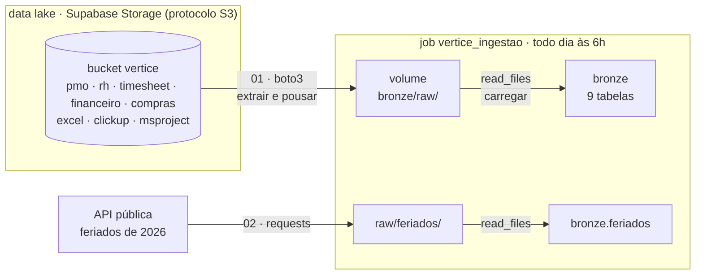
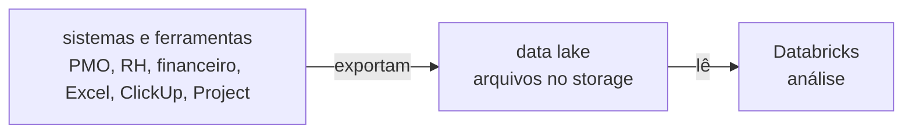

# 🛠️ Noite 2: Engenheiro de Dados | Imersão Jornada de Dados

**Terça, 20/10/2026, 19h30.**

**Ao fim desta noite você terá** as 9 tabelas da bronze recriadas **por código**, vindas de onde o dado
mora numa empresa de verdade: o **data lake** (um storage S3, aqui o Supabase), mais uma **API** de fora.
E um job que repete tudo sozinho, todo dia às 6h.

**Por que isso importa:** ontem você baixou os arquivos e subiu na mão. Funciona uma vez. Numa empresa, o
dado não está no seu computador: os sistemas e as ferramentas exportam tudo para um data lake, e chega dado
novo toda semana. Ir buscar, sem ninguém olhar, é o trabalho do engenheiro de dados.

> 📺 **Pergunta da noite:** *"E se o dado não estiver no meu computador?"*
> **Amanhã:** com a bronze vindo sozinha, o Claude Code transforma tudo em silver e gold ([prompts](README-claude-code.md)).

---

## 🏗️ O desenho da noite

| Bloco | Tempo | O que acontece |
|---|---|---|
| Aquecimento de Python | 20 min | variáveis, listas, dicionários, `for`, funções, `requests`, `pandas` e `boto3` |
| Teoria | 15 min | data lake, protocolo S3, extrair-pousar-carregar, a regra da bronze |
| Data lake → raw → bronze | 30 min | o `boto3` traz os arquivos para o raw e o `read_files` recria as 9 tabelas |
| API → bronze | 10 min | os feriados, uma fonte de fora |
| Job de ingestão | 10 min | tudo isso sozinho, todo dia às 6h |

A noite **termina na bronze**. Limpar, juntar as três ferramentas e calcular os KPIs é amanhã, com o
Claude Code.

---

## 🧠 A teoria, em 5 ideias

**1. Onde o dado mora.** O sistema que roda a operação guarda tudo num banco transacional, feito para
gravar e ler poucas linhas muito rápido. Ninguém roda análise pesada ali. Os sistemas e as ferramentas
**exportam arquivos** para um storage barato na nuvem, o **data lake**, e a plataforma analítica lê de lá.

**2. O protocolo S3.** O S3 é o storage de arquivos da AWS e virou o padrão do mercado: quase todo storage
fala o mesmo protocolo, inclusive o do Supabase. O `boto3` é a biblioteca da AWS; com o `endpoint_url`
apontando para o Supabase, **o mesmo código funciona na Amazon**.

| Termo | O que é | Aqui |
|---|---|---|
| Bucket | a pasta raiz, o "balde" | `vertice` |
| Key | o caminho do arquivo dentro do bucket | `pmo/projetos.csv` |
| Endpoint | o endereço do serviço | `https://<ref>.storage.supabase.co/storage/v1/s3` |
| Access key / secret | o usuário e a senha da máquina | no README, na tabela abaixo |

**3. Extrair, pousar, carregar.** Buscar na origem, guardar uma cópia do jeito que veio (o **raw**, no
volume) e só então transformar em tabela (a **bronze**). É **ELT**: carrega primeiro, transforma depois.
Com o raw guardado, reprocessar não exige buscar tudo de novo.

**4. A bronze não limpa nada.** Ela guarda o que chegou. A vírgula decimal, a data em dois formatos e o
status escrito de 12 jeitos continuam lá: são evidência do que a origem mandou. Por isso tudo entra como
**texto**. Limpar é a silver, amanhã. E é **idempotente**: rodar duas vezes dá o mesmo resultado que uma
(`CREATE OR REPLACE`), então o job pode repetir sem medo.

**5. Credencial não vai no notebook.** Hoje a chave aparece no código para ficar simples de ver. Numa
empresa ela fica num *secret scope* do Databricks e o notebook lê com `dbutils.secrets.get(...)`.

---

## 🔌 Os dados de conexão

| Variável | Valor |
|---|---|
| `S3_ENDPOINT` | `https://A-DEFINIR.storage.supabase.co/storage/v1/s3` |
| `S3_REGION` | `A-DEFINIR` |
| `S3_BUCKET` | `vertice` |
| `ACCESS_KEY` | `A-DEFINIR` |
| `SECRET_KEY` | `A-DEFINIR` |

Cole na célula de configuração dos notebooks (onde está `COLE-AQUI`).

---

## 🚀 Passo a passo

**0. Antes de começar**

- **Computação serverless** em todos os notebooks: ela tem acesso à internet e já traz o `boto3`.
- **Conta verificada.** A Free Edition só acessa a internet com a conta verificada. Se aparecer
  `ConnectionError` ou `Max retries exceeded`, verifique a conta quando o Databricks pedir.
- **Importe os notebooks:** no Databricks, **Workspace › (seu usuário) › Import › URL** e cole, um de cada vez:

| Notebook | URL para importar |
|---|---|
| `00_aquecimento_python` | `https://raw.githubusercontent.com/lvgalvao/ImersaoControlTower/main/aulas/aula-02-engenheiro/00_aquecimento_python.py` |
| `01_ingestao_raw` | `https://raw.githubusercontent.com/lvgalvao/ImersaoControlTower/main/aulas/aula-02-engenheiro/01_ingestao_raw.py` |
| `02_api_feriados` | `https://raw.githubusercontent.com/lvgalvao/ImersaoControlTower/main/aulas/aula-02-engenheiro/02_api_feriados.py` |

As respostas do aquecimento estão no [`00_aquecimento_python_gabarito.py`](00_aquecimento_python_gabarito.py).

**1. Aquecimento de Python** · [`00_aquecimento_python`](00_aquecimento_python.py)

Dez exercícios: variáveis, listas, dicionários, `for`, `if`, funções, `requests` numa API, `pandas`, e o
`boto3` listando e baixando um arquivo do data lake (`pmo/projetos.csv`).

**2. Data lake → raw → bronze** · [`01_ingestao_raw`](01_ingestao_raw.py)

1. Conecta no data lake com o `boto3` e lista os buckets.
2. Lista tudo o que tem no bucket `vertice`, pasta por pasta.
3. **Apaga o trabalho manual de ontem** (de propósito): as pastas do raw e as 9 tabelas da bronze.
4. Baixa cada arquivo para o raw, no mesmo caminho do bucket.
5. Roda o mesmo `read_files` de ontem e recria as 9 tabelas.

**3. API → bronze** · [`02_api_feriados`](02_api_feriados.py)

Os feriados de 2026 da BrasilAPI: uma fonte que não é da empresa. Pergunta de negócio: quantos dias
úteis a Vértice perde em novembro, bem quando começa o freeze da Black Friday?

**4. O job: tudo sozinho, todo dia às 6h**

1. **Jobs & Pipelines › Create › Job**, nome `vertice_ingestao`.
2. Tarefa `data_lake`: tipo **Notebook**, o `01_ingestao_raw`, computação **Serverless**.
3. **+ Add task** `api`: o `02_api_feriados`. Depende de: `data_lake`.
4. **Schedules & Triggers › Add trigger › Scheduled**: todo dia às 06:00 (America/Sao_Paulo).
5. **Run now** e acompanhe as caixas ficarem verdes.

---

## 🔢 O que deve aparecer na sua tela

A bronze que volta é **idêntica** à de ontem: mesmas tabelas, mesmas colunas, mesmas linhas.

| Tabela | Linhas | Veio de |
|---|---:|---|
| `bronze.apontamentos` | 30.883 | `timesheet/apontamentos.csv` |
| `bronze.custos` | 23.640 | `financeiro/custos.csv` |
| `bronze.status_semanal` | 3.911 | `pmo/status_semanal.csv` |
| `bronze.clickup_tarefas` | 2.119 | `clickup/` (25 JSON) |
| `bronze.excel_tarefas` | 1.663 | `excel/` (20 planilhas) |
| `bronze.msproject_tarefas` | 1.260 | `msproject/` (15 XML) |
| `bronze.entregas_fornecedor` | 640 | `compras/entregas_fornecedor.csv` |
| `bronze.colaboradores` | 523 | `rh/colaboradores.csv` |
| `bronze.projetos` | 60 | `pmo/projetos.csv` |
| `bronze.feriados` | 14 | API (2 em dia útil em novembro) |

---

## 🆘 Se der errado

| Sintoma | Causa | O que fazer |
|---|---|---|
| `ConnectionError`, `Max retries exceeded` | sem internet | computação serverless e conta verificada |
| `EndpointConnectionError` | endpoint errado | confira o `S3_ENDPOINT`, com `/storage/v1/s3` no fim |
| `InvalidAccessKeyId`, `SignatureDoesNotMatch` | chave ou segredo errados | copie de novo da tabela de conexão, sem espaço |
| `KeyError: 'Contents'` | bucket vazio ou nome errado | o bucket é `vertice`, em minúsculas |
| `PATH_NOT_FOUND` no `read_files` | o passo 4 não rodou | rode a célula que baixa os arquivos |
| a contagem não bate com a de ontem | faltou arquivo no bucket | o passo 2 mostra quantos arquivos tem em cada pasta |

---

## 🧑‍🏫 Para o professor: montar o data lake no Supabase

1. **Storage › New bucket**, nome `vertice`.
2. Suba as pastas de [`dados/`](../../dados) **com os mesmos nomes**: `pmo/`, `rh/`, `timesheet/`,
   `financeiro/`, `compras/`, `excel/`, `clickup/` e `msproject/` (o `read_files` procura nesses caminhos).
   Gere os dados com `python3 material/gerar_dataset.py --saida ./dados --seed 42`.
3. **Project Settings › Storage › S3 access keys › New access key.** Guarde as duas partes.
4. Na mesma tela estão o **endpoint** e a **região**. Preencha a tabela de conexão acima.

> **Cuidado:** a chave S3 do Supabase tem acesso total ao storage (lê, grava e apaga). Publicar a chave
> para a turma significa que qualquer pessoa pode apagar o bucket. Tenha o `dados/` à mão para subir de
> novo, ou troque a chave depois da aula.

---

## 📁 O que tem nesta pasta

| Arquivo | O que é |
|---|---|
| `00_aquecimento_python.py` · `_gabarito.py` | o aquecimento: exercícios e respostas |
| `01_ingestao_raw.py` | data lake (S3, `boto3`) → raw → as 9 tabelas da bronze |
| `02_api_feriados.py` | API → raw → `bronze.feriados` |
| `README-claude-code.md` | **amanhã**: o passo a passo do Claude Code e os prompts 1 a 5 |
| `prd/` · `vertice/` | os prompts e o gabarito do bundle (noite 3) |

## ➡️ Amanhã

A bronze agora chega sozinha. Amanhã o Claude Code transforma essa bronze num projeto de verdade: as
três ferramentas viram uma tabela (silver), os KPIs com teste (gold), a IA lendo o status e o dono
perguntando em português. O passo a passo está em [`README-claude-code.md`](README-claude-code.md).
