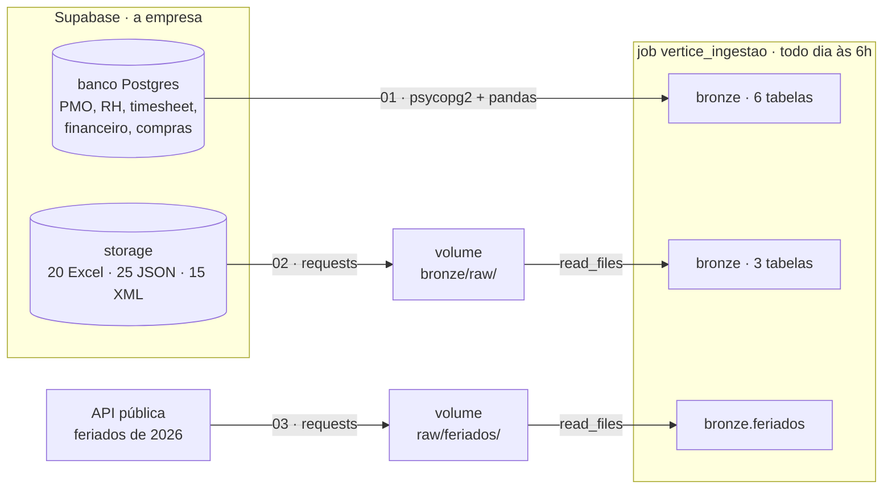
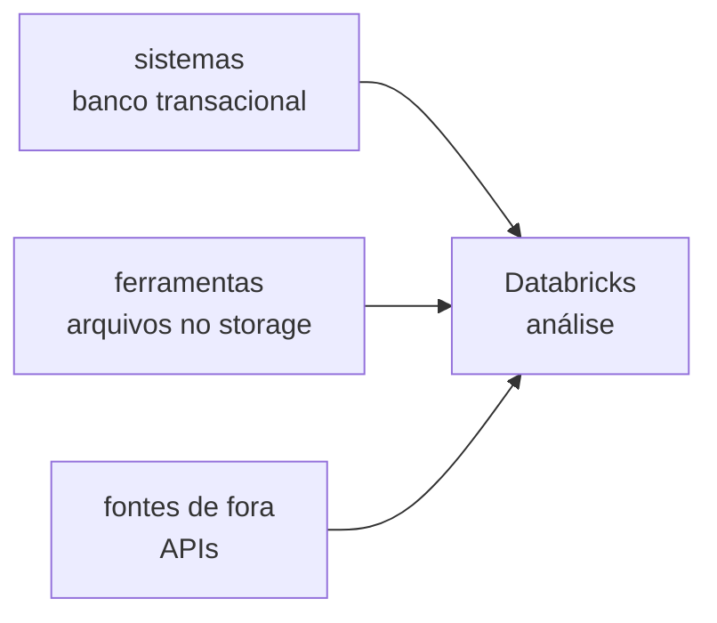

# 🛠️ Noite 2: Engenheiro de Dados | Imersão Jornada de Dados

**Terça, 20/10/2026, 19h30.**

**Ao fim desta noite você terá** as 9 tabelas da bronze recriadas **por código**, vindas de onde o dado
mora numa empresa de verdade: o **banco** dos sistemas e o **storage** de arquivos (os dois no Supabase),
mais uma **API** de fora. E um job que repete tudo sozinho, todo dia às 6h.

**Por que isso importa:** ontem você baixou arquivos e subiu na mão. Funciona uma vez. Numa empresa, o
dado não está no seu computador: está nos sistemas, e chega dado novo toda semana. Ir buscar, sem
ninguém olhar, é o trabalho do engenheiro de dados.

> 📺 **Pergunta da noite:** *"E se o dado não estiver no meu computador?"*
> **Amanhã:** com a bronze vindo sozinha, o Claude Code transforma tudo em silver e gold ([prompts](README-claude-code.md)).

---

## 🏗️ O desenho da noite



| Bloco | Tempo | O que acontece |
|---|---|---|
| Aquecimento de Python | 20 min | variáveis, listas, dicionários, `for`, funções, `requests`, `pandas` |
| Teoria | 15 min | banco × data lake, extrair-pousar-carregar, a regra da bronze |
| Banco → bronze | 20 min | as 6 tabelas dos sistemas, com `psycopg2` + `pandas` + Spark |
| Storage → bronze | 20 min | os 60 arquivos das ferramentas, com `requests` + `read_files` |
| API → bronze | 10 min | os feriados, uma fonte de fora |
| Job de ingestão | 5 min | tudo isso sozinho, todo dia às 6h |

A noite **termina na bronze**. Limpar, juntar as três ferramentas e calcular os KPIs é amanhã, com o
Claude Code.

---

## 🧠 A teoria, em 5 ideias

**1. Onde o dado mora.** O sistema que roda a operação guarda tudo num **banco transacional** (Postgres,
SQL Server): feito para gravar e ler poucas linhas, muito rápido. Ninguém roda `GROUP BY` pesado ali,
porque competiria com a operação. O que é arquivo (planilha, export de ferramenta) fica num **storage**,
o data lake. A plataforma analítica lê dos dois.



**2. Extrair, pousar, carregar.** Toda ingestão tem três passos: buscar o dado na origem, guardar uma
cópia do jeito que veio (o volume) e transformar em tabela (a bronze). É **ELT**: carrega primeiro,
transforma depois, dentro da plataforma.

**3. A bronze não limpa nada.** Ela guarda o que chegou. A vírgula decimal, a data em dois formatos e o
status escrito de 12 jeitos continuam lá: são evidência do que a origem mandou. Por isso tudo entra como
**texto**. Limpar é a silver, amanhã.

**4. Idempotente.** Rodar duas vezes dá o mesmo resultado que rodar uma (`overwrite`, `CREATE OR
REPLACE`). É o que deixa o job reexecutar sem medo depois de uma falha.

**5. Credencial não vai no notebook.** Hoje a senha do banco aparece no código porque o usuário `aluno`
**só lê** (não apaga nem altera nada). Numa empresa ela fica num *secret scope* do Databricks e o
notebook lê com `dbutils.secrets.get(...)`.

---

## 🔌 Os dados de conexão

| O quê | Valor |
|---|---|
| Banco · host | `A-DEFINIR.pooler.supabase.com` |
| Banco · porta | `5432` |
| Banco · usuário | `aluno.A-DEFINIR` |
| Banco · senha | `A-DEFINIR` (só leitura) |
| Storage | `https://A-DEFINIR.supabase.co/storage/v1/object/public/vertice` |

Cole esses valores na célula de configuração de cada notebook (onde está `COLE-AQUI`).

---

## 🚀 Passo a passo

**0. Antes de começar**

- **Computação serverless** em todos os notebooks: ela tem acesso à internet.
- **Conta verificada.** A Free Edition só acessa a internet com a conta verificada. Se aparecer
  `ConnectionError` ou `Max retries exceeded`, verifique a conta quando o Databricks pedir.
- **Importe os notebooks:** no Databricks, **Workspace › (seu usuário) › Import › URL** e cole, um de cada vez:

| Notebook | URL para importar |
|---|---|
| `00_aquecimento_python` | `https://raw.githubusercontent.com/lvgalvao/ImersaoControlTower/main/aulas/aula-02-engenheiro/00_aquecimento_python.py` |
| `01_ingestao_banco` | `https://raw.githubusercontent.com/lvgalvao/ImersaoControlTower/main/aulas/aula-02-engenheiro/01_ingestao_banco.py` |
| `02_ingestao_arquivos` | `https://raw.githubusercontent.com/lvgalvao/ImersaoControlTower/main/aulas/aula-02-engenheiro/02_ingestao_arquivos.py` |
| `03_api_feriados` | `https://raw.githubusercontent.com/lvgalvao/ImersaoControlTower/main/aulas/aula-02-engenheiro/03_api_feriados.py` |

As respostas do aquecimento estão no [`00_aquecimento_python_gabarito.py`](00_aquecimento_python_gabarito.py).

**1. Aquecimento de Python** · [`00_aquecimento_python`](00_aquecimento_python.py)

Dez exercícios, do `print` ao banco. Os de 1 a 8 rodam sem configurar nada; o 9 (storage) e o 10
(banco) usam os dados de conexão acima.

**2. Banco → bronze** · [`01_ingestao_banco`](01_ingestao_banco.py)

Apaga as 6 tabelas que você subiu ontem (de propósito) e traz de volta do banco: `projetos`,
`status_semanal`, `colaboradores`, `apontamentos`, `custos` e `entregas_fornecedor`. Uma função
`banco_para_bronze(tabela)` e um `for`: o mesmo código para as 6.

**3. Storage → bronze** · [`02_ingestao_arquivos`](02_ingestao_arquivos.py)

Lê o `manifesto.json` (a lista dos arquivos), baixa as 20 planilhas, os 25 JSON e os 15 XML para o
volume e roda o mesmo `read_files` de ontem para `excel_tarefas`, `clickup_tarefas` e `msproject_tarefas`.

**4. API → bronze** · [`03_api_feriados`](03_api_feriados.py)

Os feriados de 2026 da BrasilAPI: uma fonte que não é da empresa. Pergunta de negócio: quantos dias
úteis a Vértice perde em novembro, bem quando começa o freeze da Black Friday?

**5. O job: tudo sozinho, todo dia às 6h**

1. **Jobs & Pipelines › Create › Job**, nome `vertice_ingestao`.
2. Tarefa `banco`: tipo **Notebook**, o `01_ingestao_banco`, computação **Serverless**.
3. **+ Add task** `arquivos`: o `02_ingestao_arquivos`. Depende de: `banco`.
4. **+ Add task** `api`: o `03_api_feriados`. Depende de: `arquivos`.
5. **Schedules & Triggers › Add trigger › Scheduled**: todo dia às 06:00 (America/Sao_Paulo).
6. **Run now** e acompanhe as 3 caixas ficarem verdes.

> Os notebooks começam apagando a tabela e terminam recriando. Como são idempotentes, o job pode rodar
> de novo a qualquer hora.

---

## 🔢 O que deve aparecer na sua tela

A bronze que volta é **idêntica** à de ontem: mesmas tabelas, mesmas colunas, mesmas linhas.

| Tabela | Linhas | Veio de |
|---|---:|---|
| `bronze.apontamentos` | 30.883 | banco |
| `bronze.custos` | 23.640 | banco |
| `bronze.status_semanal` | 3.911 | banco |
| `bronze.clickup_tarefas` | 2.119 | storage (25 JSON) |
| `bronze.excel_tarefas` | 1.663 | storage (20 Excel) |
| `bronze.msproject_tarefas` | 1.260 | storage (15 XML) |
| `bronze.entregas_fornecedor` | 640 | banco |
| `bronze.colaboradores` | 523 | banco |
| `bronze.projetos` | 60 | banco |
| `bronze.feriados` | 14 | API (2 em dia útil em novembro) |

---

## 🆘 Se der errado

| Sintoma | Causa | O que fazer |
|---|---|---|
| `ConnectionError`, `Max retries exceeded` | sem internet | computação serverless e conta verificada |
| `ModuleNotFoundError: psycopg2` | biblioteca não instalada | rode a célula do `%pip install psycopg2-binary` |
| `password authentication failed` | usuário no formato errado | o usuário do pooler é `aluno.<ref>`, com o ponto |
| `404` ao baixar do storage | endereço `STORAGE` errado | confira a URL da tabela de conexão, sem `/` no fim |
| `PATH_NOT_FOUND` no `read_files` | o passo 2 do notebook 02 não rodou | rode a célula que baixa os arquivos |
| o job falha numa tarefa | a anterior não terminou | abra a caixa vermelha: o erro está na saída da célula |

---

## 🧑‍🏫 Para o professor: montar a empresa no Supabase

Uma vez, antes da aula: crie o projeto no painel do Supabase e rode
[`material/carregar_supabase.py`](../../material/carregar_supabase.py). Ele cria o schema `vertice` com
as 6 tabelas (tudo texto, do jeito do CSV), o usuário `aluno` só de leitura, o bucket público `vertice`
com os 60 arquivos e o `manifesto.json`.

```bash
pip install psycopg2-binary requests
export SUPABASE_DB_URL="postgresql://postgres.<ref>:<senha>@<host>.pooler.supabase.com:5432/postgres"
export SUPABASE_URL="https://<ref>.supabase.co"
export SUPABASE_SERVICE_KEY="<service_role key>"
export ALUNO_SENHA="<senha só de leitura, vai no README>"
python3 material/carregar_supabase.py --dados ./dados
```

---

## 📁 O que tem nesta pasta

| Arquivo | O que é |
|---|---|
| `00_aquecimento_python.py` · `_gabarito.py` | o aquecimento: exercícios e respostas |
| `01_ingestao_banco.py` | banco (Supabase Postgres) → 6 tabelas da bronze |
| `02_ingestao_arquivos.py` | storage (Supabase) → volume → 3 tabelas da bronze |
| `03_api_feriados.py` | API → volume → `bronze.feriados` |
| `README-claude-code.md` | **amanhã**: o passo a passo do Claude Code e os prompts 1 a 5 |
| `prd/` · `vertice/` | os prompts e o gabarito do bundle (noite 3) |

## ➡️ Amanhã

A bronze agora chega sozinha. Amanhã o Claude Code transforma essa bronze num projeto de verdade: as
três ferramentas viram uma tabela (silver), os KPIs com teste (gold), a IA lendo o status e o dono
perguntando em português. O passo a passo está em [`README-claude-code.md`](README-claude-code.md).
