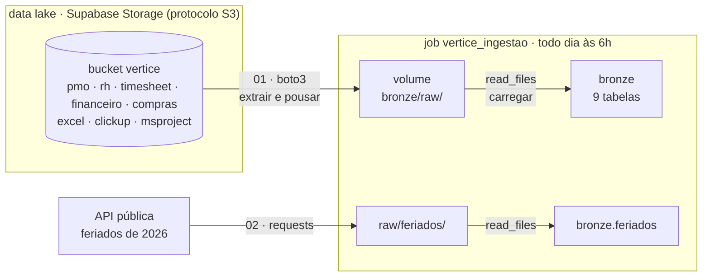
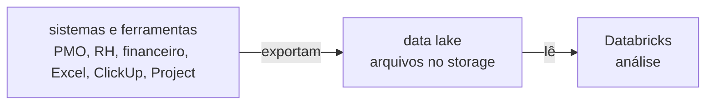

# 🛠️ Noite 2: Engenheiro de Dados | Imersão Jornada de Dados

**Terça, 20/10/2026, 19h30.**

**Ao fim desta noite você terá** as 9 tabelas da bronze recriadas **por código**, vindas de onde o dado
mora numa empresa de verdade: o **data lake** (um storage S3, aqui o Supabase), mais uma **API** de fora.
E um job que repete tudo sozinho, todo dia às 6h.

**Por que isso importa:** ontem você baixou os arquivos e subiu na mão. Funciona uma vez. Numa empresa, o
dado não está no seu computador: os sistemas e as ferramentas exportam tudo para um data lake, e chega dado
novo toda semana. Ir buscar, sem ninguém olhar, é o trabalho do engenheiro de dados.

> 📺 **Pergunta da noite:** *"E se o dado não estiver no meu computador?"*
> **Amanhã:** com a bronze vindo sozinha, o Claude Code transforma tudo em silver e gold ([prompts](README-claude-code.md)).

---

## 🏗️ O desenho da noite



| Bloco | Tempo | O que acontece |
|---|---|---|
| Aquecimento de Python | 20 min | variáveis, listas, dicionários, `for`, funções, `requests`, `pandas` e `boto3` |
| Teoria | 15 min | data lake, protocolo S3, extrair-pousar-carregar, a regra da bronze |
| Data lake → raw → bronze | 30 min | o `boto3` traz os arquivos para o raw e o `read_files` recria as 9 tabelas |
| API → bronze | 10 min | os feriados, uma fonte de fora |
| Job de ingestão | 10 min | tudo isso sozinho, todo dia às 6h |

A noite **termina na bronze**. Limpar, juntar as três ferramentas e calcular os KPIs é amanhã, com o
Claude Code.

---

## 🧠 A teoria, em 5 ideias

**1. Onde o dado mora.** O sistema que roda a operação guarda tudo num banco transacional, feito para
gravar e ler poucas linhas muito rápido. Ninguém roda análise pesada ali. Os sistemas e as ferramentas
**exportam arquivos** para um storage barato na nuvem, o **data lake**, e a plataforma analítica lê de lá.



**2. O protocolo S3.** O S3 é o storage de arquivos da AWS e virou o padrão do mercado: quase todo storage
fala o mesmo protocolo, inclusive o do Supabase. O `boto3` é a biblioteca da AWS; com o `endpoint_url`
apontando para o Supabase, **o mesmo código funciona na Amazon**.

| Termo | O que é | Aqui |
|---|---|---|
| Bucket | a pasta raiz, o "balde" | `vertice` |
| Key | o caminho do arquivo dentro do bucket | `pmo/projetos.csv` |
| Endpoint | o endereço do serviço | `https://<ref>.storage.supabase.co/storage/v1/s3` |
| Access key / secret | o usuário e a senha da máquina | no README, na tabela abaixo |

**3. Extrair, pousar, carregar.** Buscar na origem, guardar uma cópia do jeito que veio (o **raw**, no
volume) e só então transformar em tabela (a **bronze**). É **ELT**: carrega primeiro, transforma depois.
Com o raw guardado, reprocessar não exige buscar tudo de novo.

**4. A bronze não limpa nada.** Ela guarda o que chegou. A vírgula decimal, a data em dois formatos e o
status escrito de 12 jeitos continuam lá: são evidência do que a origem mandou. Por isso tudo entra como
**texto**. Limpar é a silver, amanhã. E é **idempotente**: rodar duas vezes dá o mesmo resultado que uma
(`CREATE OR REPLACE`), então o job pode repetir sem medo.

**5. Credencial não vai no notebook.** Hoje a chave aparece no código para ficar simples de ver. Numa
empresa ela fica num *secret scope* do Databricks e o notebook lê com `dbutils.secrets.get(...)`.

---

## 🔌 Os dados de conexão

| Variável | Valor |
|---|---|
| `S3_ENDPOINT` | `https://A-DEFINIR.storage.supabase.co/storage/v1/s3` |
| `S3_REGION` | `A-DEFINIR` |
| `S3_BUCKET` | `vertice` |
| `ACCESS_KEY` | `A-DEFINIR` |
| `SECRET_KEY` | `A-DEFINIR` |

Cole na célula de configuração dos notebooks (onde está `COLE-AQUI`).

---

## 🚀 Passo a passo

### 0. Antes de começar

- **Computação serverless** em todos os notebooks: ela tem acesso à internet e já traz o `boto3`.
- **Conta verificada.** A Free Edition só acessa a internet com a conta verificada. Se aparecer
  `ConnectionError` ou `Max retries exceeded`, verifique a conta quando o Databricks pedir.
- **Três notebooks**, um por etapa: o código de cada um está logo abaixo, célula por célula, com botão de copiar.

### 1. Aquecimento de Python (20 min)

No Databricks: **New › Notebook**, nome `00_aquecimento_python`, computação **serverless**. Cole uma célula de
cada vez e rode com **Shift+Enter**. Tente entender cada linha antes de rodar: os comentários explicam.

#### 1. Variáveis e tipos

*Célula 1*

```python
nome_tabela = "vendas"          # str  · texto sempre entre aspas
total_vendas = 3020             # int  · número inteiro, sem aspas
receita_total = 974077.28       # float· número com casas decimais (ponto, não vírgula)
pipeline_ativo = True           # bool · True ou False, com inicial maiúscula

for valor in (nome_tabela, total_vendas, receita_total, pipeline_ativo):
    print(valor, type(valor))
```

##### f-string

O `f` antes das aspas liga a interpolação; o que está entre chaves é avaliado como código.

*Célula 2*

```python
print(f"A tabela {nome_tabela} tem {total_vendas} linhas.")

# formatando número: milhar com ponto e 2 casas decimais
print(f"Receita: R$ {receita_total:,.2f}".replace(",", "X").replace(".", ",").replace("X", "."))
```

#### 2. Listas

*Célula 3*

```python
tabelas = ["vendas", "produtos", "clientes", "preco_competidores"]

print(f"São {len(tabelas)} tabelas")
print("Primeira:", tabelas[0])
print("Última:  ", tabelas[-1])     # índice negativo conta de trás para frente
```

#### 3. Dicionários

*Célula 4*

```python
venda = {
    "id_venda": "sal_adff6978b0c6",
    "canal": "loja_fisica",
    "quantidade": 2,
    "preco_unitario": 64.79,
}

receita = venda["quantidade"] * venda["preco_unitario"]
print(f"Receita da venda {venda['id_venda']}: R$ {receita:.2f}")
```

##### Dicionário dentro de dicionário

Leia de fora para dentro: `estado["regiao"]` devolve outro dicionário, e nele pedimos `["nome"]`.

*Célula 5*

```python
estado = {"sigla": "AM", "nome": "Amazonas", "regiao": {"id": 1, "sigla": "N", "nome": "Norte"}}

print(estado["regiao"]["nome"])
```

#### 4. `for` e `if`

*Célula 6*

```python
tabelas = ["vendas", "produtos", "clientes", "preco_competidores"]

for tabela in tabelas:
    print(f"Baixando {tabela}.parquet do data lake...")
```

*Célula 7*

```python
quantidades = [1, 3, 2, 5, 1]

for quantidade in quantidades:
    if quantidade > 2:
        print(f"{quantidade} unidades: venda grande")
    else:
        print(f"{quantidade} unidades: venda pequena")
```

#### 5. Funções

`def` cria a função, os parâmetros vão entre parênteses e o `return` devolve o resultado. O texto entre
três aspas é a documentação da função.

*Célula 8*

```python
def calcular_receita(quantidade, preco_unitario):
    """Receita de uma venda, arredondada em 2 casas."""
    return round(quantidade * preco_unitario, 2)


print(calcular_receita(2, 64.79))      # 129.58
print(calcular_receita(1, 1286.09))    # 1286.09
```

#### 6. Métodos: cada tipo traz as suas funções

Um **método** é uma função que já vem grudada no valor: você escreve o valor, um **ponto** e o nome.
Cada tipo tem os seus: o texto sabe ficar em minúsculas, a lista sabe crescer, o dicionário sabe listar as
chaves. No notebook, digite o valor, o ponto e aperte **Tab** para ver todos.

| Tipo | Métodos que você vai usar | O que fazem |
|---|---|---|
| `str` | `.lower()` `.upper()` `.strip()` `.replace(a, b)` `.split(sep)` `.startswith(x)` | minúsculas, maiúsculas, tirar espaços, trocar, quebrar, começa com |
| `list` | `.append(x)` `.sort()` `.count(x)` | acrescentar, ordenar, contar |
| `dict` | `.keys()` `.values()` `.items()` `.get(chave, padrão)` | as chaves, os valores, os pares, ler sem dar erro |

A sujeira da Vértice, que ontem você viu no SQL, se resolve com métodos de texto:

*Célula 9*

```python
# o farol do gerente veio escrito de vários jeitos
farol = "  VERDE "
print(farol.strip().lower())                   # "verde": um método depois do outro (encadeamento)

# o custo veio com vírgula decimal: para o Python, isso é texto, não número
valor = "12345,67"
print(float(valor.replace(",", ".")))          # 12345.67

# o projeto está escondido no nome do arquivo
arquivo = "Cronograma PRJ-002.xlsx"
print(arquivo.split(" ")[1].replace(".xlsx", ""))   # "PRJ-002"
print(arquivo.startswith("Cronograma"))             # True
```

*Célula 10*

```python
# lista: acrescentar, contar e ordenar
farois = ["verde", "amarelo", "verde"]
farois.append("vermelho")                      # a lista cresce no lugar
print(farois.count("verde"))                   # 2
farois.sort()
print(farois)                                  # ['amarelo', 'verde', 'verde', 'vermelho']

# dicionário: chaves, valores e o .get, que não quebra se a chave não existir
projeto = {"projeto_id": "PRJ-011", "cliente": "Supermercado Bom Preço", "spi": 0.77}
print(list(projeto.keys()))
print(projeto.get("cpi", "sem CPI"))           # "sem CPI", em vez de KeyError
for chave, valor in projeto.items():
    print(f"{chave}: {valor}")
```

**Objetivo:** a lista abaixo tem o farol de 5 status. Deixe todos iguais (sem espaço, minúsculos) e conte
quantos são verdes.

*Célula 11*

```python
status = [" Verde", "VERDE", "verde ", "Amarelo", "vermelho"]

limpos = [s.strip().lower() for s in status]   # o mesmo método para cada item
print(limpos)
print(limpos.count("verde"), "verdes")         # 3
```

> **Guarde esta ideia para o pandas:** uma tabela do pandas também tem métodos (`df.head()`,
> `df.describe()`) e uma coluna de texto tem os mesmos métodos do `str`, depois de um `.str`:
> `df["farol"].str.strip().str.lower()`. É o `.lower()` desta seção, aplicado à coluna inteira de uma vez.

#### 7. Bibliotecas

*Célula 12*

```python
import requests
import pandas as pd

print("pandas", pd.__version__)
print("requests", requests.__version__)
```

#### 8. Consumindo uma API

`status_code` 200 significa "deu certo". O `raise_for_status()` interrompe a execução se vier erro, o que
evita seguir o pipeline com dado vazio.

*Célula 13*

```python
URL_IBGE = "https://servicodados.ibge.gov.br/api/v1/localidades/estados"

resposta = requests.get(URL_IBGE, timeout=60)
resposta.raise_for_status()

estados = resposta.json()          # JSON vira lista de dicionários

print("status:", resposta.status_code)
print("estados recebidos:", len(estados))
print("primeiro:", estados[0])
```

#### 9. pandas

*Célula 14*

```python
# a lista de dicionários vira tabela; o json_normalize abre o dicionário "regiao" em colunas
df_estados = pd.json_normalize(estados)[["sigla", "nome", "regiao.nome"]]
df_estados = df_estados.rename(columns={"regiao.nome": "regiao"})
display(df_estados.head())

print("formato (linhas, colunas):", df_estados.shape)
print("colunas:", list(df_estados.columns))

# contagem por região: o GROUP BY do pandas
por_regiao = df_estados.groupby("regiao").size().sort_values(ascending=False)
print(por_regiao)

# filtro: o WHERE do pandas
display(df_estados[df_estados["regiao"] == "Norte"])
```

#### 10. boto3: lendo arquivos do data lake

O **boto3** é a biblioteca da AWS para falar com o **S3**, o serviço de arquivos na nuvem. O Storage do
**Supabase** fala o mesmo protocolo, então o mesmo código serve para os dois: muda só o `endpoint_url`.

| Termo | O que é |
|---|---|
| **Bucket** | A pasta raiz, o "balde" |
| **Key** | O caminho do arquivo dentro do bucket, por exemplo `pmo/projetos.csv` |
| **Endpoint** | O endereço do serviço |
| **Access key / secret** | Usuário e senha da máquina |

> Na aula a chave fica no notebook, para ser simples de ver. Em produção ela sai daqui e vai para o
> secret scope do Databricks, o que entra amanhã.

*Célula 15*

```python
import boto3

# copie do Supabase: Project Settings → Storage → S3 access keys
S3_ENDPOINT = "https://COLE-AQUI.storage.supabase.co/storage/v1/s3"
S3_REGION = "COLE-AQUI"
S3_BUCKET = "vertice"

ACCESS_KEY = "XXXX"
SECRET_KEY = "XXXX"

s3 = boto3.client(
    "s3",
    endpoint_url=S3_ENDPOINT,
    region_name=S3_REGION,
    aws_access_key_id=ACCESS_KEY,
    aws_secret_access_key=SECRET_KEY,
)

# Listar buckets
response = s3.list_buckets()

for bucket in response["Buckets"]:
    print(bucket["Name"])
```

Agora os arquivos de dentro do bucket. A resposta é um dicionário: os arquivos ficam em `Contents`, e
cada um tem `Key` (o nome) e `Size` (o tamanho em bytes).

*Célula 16*

```python
response = s3.list_objects_v2(Bucket=S3_BUCKET)

for objeto in response["Contents"]:
    print(f"{objeto['Key']:<30} {objeto['Size']:>10,} bytes")

# a forma curta, com list comprehension
arquivos = [objeto["Key"] for objeto in response["Contents"]]
print("\narquivos:", arquivos)
```

#### 11. De bytes para tabela

O `get_object` devolve um dicionário; o conteúdo está em `Body`, e o `.read()` transforma em bytes. O
pandas espera um arquivo, e o que temos são bytes na memória: o `io.BytesIO` finge ser um arquivo.

*Célula 17*

```python
import io

objeto = s3.get_object(Bucket=S3_BUCKET, Key="pmo/projetos.csv")
conteudo = objeto["Body"].read()
print(f"{len(conteudo):,} bytes baixados")

df_projetos = pd.read_csv(io.BytesIO(conteudo))
print(df_projetos.shape)
display(df_projetos.head())
```

#### Erros comuns neste esquenta

| Erro | O que aconteceu |
|---|---|
| `IndentationError` | Faltou o recuo de 4 espaços dentro do `for`, do `if` ou da função |
| `NameError: name 'x' is not defined` | A variável não existe: você rodou a célula fora de ordem |
| `KeyError: 'regiao'` | A chave não existe no dicionário; confira a grafia |
| `KeyError: 'Contents'` | O bucket está vazio ou o nome está errado |
| `ModuleNotFoundError` | Biblioteca não instalada: rode `%pip install <nome>` |
| `ConnectionError` ao chamar a API | Conta do Databricks ainda não verificada |
| `EndpointConnectionError` | Endpoint errado; confira o endereço do Storage |
| `InvalidAccessKeyId` / `SignatureDoesNotMatch` | Chave ou segredo errados |

#### Fechando o esquenta

Se você resolveu os 11 exercícios, tem tudo o que precisa para a aula:

- sabe guardar valores e percorrer listas;
- entende a resposta de uma API e a de um storage S3;
- sabe transformar bytes em tabela com o pandas;
- conhece as bibliotecas que o pipeline usa.

Siga para o **`01_ingestao_raw`**, onde todos os arquivos do data lake vão para o raw e viram a bronze.

---

### 2. Data lake → raw → bronze (30 min)

Um notebook novo, `01_ingestao_raw`, serverless. Preencha a célula de configuração com a tabela de conexão.

Ontem você baixou os arquivos e subiu no volume **na mão**. Numa empresa, os sistemas e as
ferramentas exportam tudo para um **data lake**: um storage na nuvem que fala o protocolo **S3** da AWS.
Aqui o data lake é o Storage do Supabase, e o código é exatamente o que você usaria na Amazon:
muda só o `endpoint_url`.

Os três passos de toda ingestão:
1. **extrair** · o `boto3` lista e baixa cada arquivo do bucket `vertice`
2. **pousar** · cada arquivo vai para o volume, no mesmo caminho: `/Volumes/lakehouse_vertice/bronze/raw/`
3. **carregar** · o mesmo `read_files` de ontem transforma o raw nas 9 tabelas da bronze

Rode com a computação **serverless**, uma célula de cada vez.

#### Configuração

Copie do README da noite 2. Na aula a chave fica aqui para ser simples de ver; numa empresa ela vai
para um *secret scope* e o notebook lê com `dbutils.secrets.get(...)`.

*Célula 1*

```python
S3_ENDPOINT = "https://COLE-AQUI.storage.supabase.co/storage/v1/s3"
S3_REGION   = "COLE-AQUI"
S3_BUCKET   = "vertice"
ACCESS_KEY  = "COLE-AQUI"
SECRET_KEY  = "COLE-AQUI"

RAW = "/Volumes/lakehouse_vertice/bronze/raw"
```

#### Passo 1 · Conectar no data lake

*Célula 2*

```python
import boto3

s3 = boto3.client(
    "s3",
    endpoint_url=S3_ENDPOINT,
    region_name=S3_REGION,
    aws_access_key_id=ACCESS_KEY,
    aws_secret_access_key=SECRET_KEY,
)

for bucket in s3.list_buckets()["Buckets"]:
    print(bucket["Name"])
```

#### Passo 2 · O que tem no bucket?

Cada arquivo é um objeto com uma **Key** (o caminho) e um **Size**. O S3 devolve no máximo 1.000
por página; o *paginator* busca todas as páginas.

*Célula 3*

```python
objetos = []
for pagina in s3.get_paginator("list_objects_v2").paginate(Bucket=S3_BUCKET):
    objetos += pagina.get("Contents", [])

# só arquivos (o storage cria um objeto vazio de marcação em cada pasta)
arquivos = [o["Key"] for o in objetos if not o["Key"].endswith("/") and o["Size"] > 0
            and not o["Key"].endswith(".emptyFolderPlaceholder")]

from collections import Counter
for pasta, n in sorted(Counter(k.split("/")[0] for k in arquivos).items()):
    print(f"{pasta:<12} {n:>3} arquivos")
print(f"{'total':<12} {len(arquivos):>3}")
```

#### Passo 3 · Apague o trabalho manual de ontem

É proposital: as pastas do raw e as 9 tabelas da bronze somem, e voltam vindas do data lake.

*Célula 4*

```python
TABELAS = ["projetos", "status_semanal", "excel_tarefas", "clickup_tarefas", "msproject_tarefas",
           "colaboradores", "apontamentos", "custos", "entregas_fornecedor"]

for tabela in TABELAS:
    spark.sql(f"DROP TABLE IF EXISTS lakehouse_vertice.bronze.{tabela}")

for pasta in sorted({k.split("/")[0] for k in arquivos}):
    dbutils.fs.rm(f"{RAW}/{pasta}", True)
    print("apagada:", f"{RAW}/{pasta}")
```

#### Passo 4 · Extrair e pousar: cada arquivo do bucket vai para o raw

*Célula 5*

```python
import os

def baixar(key):
    destino = f"{RAW}/{key}"                                   # o mesmo caminho do bucket
    os.makedirs(os.path.dirname(destino), exist_ok=True)
    conteudo = s3.get_object(Bucket=S3_BUCKET, Key=key)["Body"].read()   # 1 · extrair
    with open(destino, "wb") as f:                                        # 2 · pousar
        f.write(conteudo)
    return len(conteudo)

total = 0
for key in arquivos:
    total += baixar(key)
print(f"{len(arquivos)} arquivos, {total/1e6:.1f} MB no raw")
```

#### Passo 5 · Carregar: o raw vira a bronze, com o mesmo SQL de ontem

Tudo como texto, sem limpar nada: a bronze guarda o que chegou. A limpeza é amanhã, na silver.

*Célula 6*

```sql
%sql
CREATE OR REPLACE TABLE lakehouse_vertice.bronze.projetos AS
SELECT * EXCEPT (_rescued_data)
FROM read_files('/Volumes/lakehouse_vertice/bronze/raw/pmo/projetos.csv',
                format => 'csv', header => true, inferColumnTypes => false);

CREATE OR REPLACE TABLE lakehouse_vertice.bronze.status_semanal AS
SELECT * EXCEPT (_rescued_data)
FROM read_files('/Volumes/lakehouse_vertice/bronze/raw/pmo/status_semanal.csv',
                format => 'csv', header => true, inferColumnTypes => false);

CREATE OR REPLACE TABLE lakehouse_vertice.bronze.colaboradores AS
SELECT * EXCEPT (_rescued_data)
FROM read_files('/Volumes/lakehouse_vertice/bronze/raw/rh/colaboradores.csv',
                format => 'csv', header => true, inferColumnTypes => false);

CREATE OR REPLACE TABLE lakehouse_vertice.bronze.apontamentos AS
SELECT * EXCEPT (_rescued_data)
FROM read_files('/Volumes/lakehouse_vertice/bronze/raw/timesheet/apontamentos.csv',
                format => 'csv', header => true, inferColumnTypes => false);

CREATE OR REPLACE TABLE lakehouse_vertice.bronze.custos AS
SELECT * EXCEPT (_rescued_data)
FROM read_files('/Volumes/lakehouse_vertice/bronze/raw/financeiro/custos.csv',
                format => 'csv', header => true, inferColumnTypes => false);

CREATE OR REPLACE TABLE lakehouse_vertice.bronze.entregas_fornecedor AS
SELECT * EXCEPT (_rescued_data)
FROM read_files('/Volumes/lakehouse_vertice/bronze/raw/compras/entregas_fornecedor.csv',
                format => 'csv', header => true, inferColumnTypes => false);
```

*Célula 7*

```sql
%sql
CREATE OR REPLACE TABLE lakehouse_vertice.bronze.excel_tarefas AS
SELECT `ID`               AS id,
       `Fase`             AS fase,
       `Tarefa`           AS tarefa,
       `Responsável`      AS responsavel,
       `Início previsto`  AS inicio_previsto,
       `Término previsto` AS termino_previsto,
       `Início real`      AS inicio_real,
       `Término real`     AS termino_real,
       `% Concluído`      AS pct_concluido,
       `Horas previstas`  AS horas_previstas,
       url_decode(_metadata.file_name) AS arquivo
FROM read_files('/Volumes/lakehouse_vertice/bronze/raw/excel/',
                format => 'excel', headerRows => 1, inferColumnTypes => false);

CREATE OR REPLACE TABLE lakehouse_vertice.bronze.clickup_tarefas AS
SELECT list.id   AS list_id,
       list.name AS list_name,
       t.*,
       url_decode(_metadata.file_name) AS arquivo
FROM (
    SELECT list, explode(tasks) AS t, _metadata
    FROM read_files('/Volumes/lakehouse_vertice/bronze/raw/clickup/',
                    format => 'json', multiLine => true)
);

CREATE OR REPLACE TABLE lakehouse_vertice.bronze.msproject_tarefas AS
SELECT * EXCEPT (_rescued_data),
       url_decode(_metadata.file_name) AS arquivo
FROM read_files('/Volumes/lakehouse_vertice/bronze/raw/msproject/',
                format => 'xml', rowTag => 'Task');
```

*Célula 8*

```sql
%sql
-- Deve aparecer o mesmo de ontem:
-- apontamentos 30.883 · custos 23.640 · status_semanal 3.911 · clickup_tarefas 2.119 · excel_tarefas 1.663
-- msproject_tarefas 1.260 · entregas_fornecedor 640 · colaboradores 523 · projetos 60
SELECT 'projetos' AS tabela, COUNT(*) AS linhas FROM lakehouse_vertice.bronze.projetos
UNION ALL SELECT 'status_semanal', COUNT(*) FROM lakehouse_vertice.bronze.status_semanal
UNION ALL SELECT 'excel_tarefas', COUNT(*) FROM lakehouse_vertice.bronze.excel_tarefas
UNION ALL SELECT 'clickup_tarefas', COUNT(*) FROM lakehouse_vertice.bronze.clickup_tarefas
UNION ALL SELECT 'msproject_tarefas', COUNT(*) FROM lakehouse_vertice.bronze.msproject_tarefas
UNION ALL SELECT 'colaboradores', COUNT(*) FROM lakehouse_vertice.bronze.colaboradores
UNION ALL SELECT 'apontamentos', COUNT(*) FROM lakehouse_vertice.bronze.apontamentos
UNION ALL SELECT 'custos', COUNT(*) FROM lakehouse_vertice.bronze.custos
UNION ALL SELECT 'entregas_fornecedor', COUNT(*) FROM lakehouse_vertice.bronze.entregas_fornecedor
ORDER BY linhas DESC
```

---

### 3. API → bronze (10 min)

Um notebook novo, `02_api_feriados`, serverless.

Na empresa, o dado não chega pronto: alguém precisa ir buscar. Quando a fonte não tem conector,
entra o Python. O caminho é o mesmo da noite 1, em três passos:

1. **extrair** · o Python pede os feriados de 2026 a uma API pública (a BrasilAPI, sem chave)
2. **pousar** · o JSON vai para o volume, do jeito que veio: `/Volumes/lakehouse_vertice/bronze/raw/feriados/`
3. **carregar** · o `read_files` transforma o arquivo em tabela: `lakehouse_vertice.bronze.feriados`

**Pergunta de negócio:** quantos dias úteis a Vértice perde em novembro, bem quando começa o
change freeze da Black Friday (01/11)?

Rode com a computação **serverless** (ela tem internet), uma célula de cada vez.

*Célula 1*

```python
# 1 · EXTRAIR: o Python pede o dado à API
import requests                # conversa com a API (HTTP)

url = "https://brasilapi.com.br/api/feriados/v1/2026"
resposta = requests.get(url, timeout=30)
resposta.raise_for_status()    # se a API cair, para aqui com o erro, em vez de seguir com nada

feriados = resposta.json()     # o JSON vira uma lista do Python: um dicionário por feriado
print(len(feriados), "feriados")
feriados[:3]
```

*Célula 2*

```python
# 2 · POUSAR: o arquivo vai para o volume, do jeito que veio
import json, os               # json e os já vêm no Python

pasta = "/Volumes/lakehouse_vertice/bronze/raw/feriados"
os.makedirs(pasta, exist_ok=True)              # a pasta nova precisa existir

with open(f"{pasta}/feriados_2026.json", "w") as arquivo:
    json.dump(feriados, arquivo, ensure_ascii=False)

os.listdir(pasta)                              # deve aparecer: ['feriados_2026.json']
```

*Célula 3*

```sql
%sql
-- 3 · CARREGAR: o mesmo read_files da noite 1, agora numa pasta nova do volume
CREATE OR REPLACE TABLE lakehouse_vertice.bronze.feriados
COMMENT 'Feriados nacionais de 2026, da BrasilAPI. Ingestão por API: Python busca, o arquivo pousa no volume, o read_files carrega.'
AS SELECT date AS data, name AS feriado, type AS tipo, weekday AS dia_da_semana,
          _metadata.file_name AS arquivo
FROM read_files('/Volumes/lakehouse_vertice/bronze/raw/feriados/', format => 'json', multiLine => true)
```

*Célula 4*

```sql
%sql
-- Deve aparecer: 02/11 (segunda), 15/11 (domingo) e 20/11 (sexta).
-- 2 dias úteis a menos em novembro, logo no começo do freeze da Black Friday.
SELECT data, feriado, dia_da_semana
FROM lakehouse_vertice.bronze.feriados
WHERE data BETWEEN '2026-11-01' AND '2026-11-30'
ORDER BY data
```

---

### 4. O job: tudo sozinho, todo dia às 6h

1. **Jobs & Pipelines › Create › Job**, nome `vertice_ingestao`.
2. Tarefa `data_lake`: tipo **Notebook**, o seu `01_ingestao_raw`, computação **Serverless**.
3. **+ Add task** `api`: o seu `02_api_feriados`. Depende de: `data_lake`.
4. **Schedules & Triggers › Add trigger › Scheduled**: todo dia às 06:00 (America/Sao_Paulo).
5. **Run now** e acompanhe as caixas ficarem verdes.

---

## 🔢 O que deve aparecer na sua tela

A bronze que volta é **idêntica** à de ontem: mesmas tabelas, mesmas colunas, mesmas linhas.

| Tabela | Linhas | Veio de |
|---|---:|---|
| `bronze.apontamentos` | 30.883 | `timesheet/apontamentos.csv` |
| `bronze.custos` | 23.640 | `financeiro/custos.csv` |
| `bronze.status_semanal` | 3.911 | `pmo/status_semanal.csv` |
| `bronze.clickup_tarefas` | 2.119 | `clickup/` (25 JSON) |
| `bronze.excel_tarefas` | 1.663 | `excel/` (20 planilhas) |
| `bronze.msproject_tarefas` | 1.260 | `msproject/` (15 XML) |
| `bronze.entregas_fornecedor` | 640 | `compras/entregas_fornecedor.csv` |
| `bronze.colaboradores` | 523 | `rh/colaboradores.csv` |
| `bronze.projetos` | 60 | `pmo/projetos.csv` |
| `bronze.feriados` | 14 | API (2 em dia útil em novembro) |

---

## 🆘 Se der errado

| Sintoma | Causa | O que fazer |
|---|---|---|
| `ConnectionError`, `Max retries exceeded` | sem internet | computação serverless e conta verificada |
| `EndpointConnectionError` | endpoint errado | confira o `S3_ENDPOINT`, com `/storage/v1/s3` no fim |
| `InvalidAccessKeyId`, `SignatureDoesNotMatch` | chave ou segredo errados | copie de novo da tabela de conexão, sem espaço |
| `KeyError: 'Contents'` | bucket vazio ou nome errado | o bucket é `vertice`, em minúsculas |
| `PATH_NOT_FOUND` no `read_files` | o passo 4 não rodou | rode a célula que baixa os arquivos |
| a contagem não bate com a de ontem | faltou arquivo no bucket | o passo 2 mostra quantos arquivos tem em cada pasta |

---

## 🧑‍🏫 Para o professor: montar o data lake no Supabase

1. **Storage › New bucket**, nome `vertice`.
2. Suba as pastas de [`dados/`](../../dados) **com os mesmos nomes**: `pmo/`, `rh/`, `timesheet/`,
   `financeiro/`, `compras/`, `excel/`, `clickup/` e `msproject/` (o `read_files` procura nesses caminhos).
   Gere os dados com `python3 material/gerar_dataset.py --saida ./dados --seed 42`.
3. **Project Settings › Storage › S3 access keys › New access key.** Guarde as duas partes.
4. Na mesma tela estão o **endpoint** e a **região**. Preencha a tabela de conexão acima.

> **Cuidado:** a chave S3 do Supabase tem acesso total ao storage (lê, grava e apaga). Publicar a chave
> para a turma significa que qualquer pessoa pode apagar o bucket. Tenha o `dados/` à mão para subir de
> novo, ou troque a chave depois da aula.

---

## 📁 O que tem nesta pasta

| Arquivo | O que é |
|---|---|
| `README.md` | esta noite: a teoria e todo o código, célula por célula |
| `README-claude-code.md` | **amanhã**: o passo a passo do Claude Code e os prompts 1 a 5 |
| `prd/` · `vertice/` | os prompts e o gabarito do bundle (noite 3) |

## ➡️ Amanhã

A bronze agora chega sozinha. Amanhã o Claude Code transforma essa bronze num projeto de verdade: as
três ferramentas viram uma tabela (silver), os KPIs com teste (gold), a IA lendo o status e o dono
perguntando em português. O passo a passo está em [`README-claude-code.md`](README-claude-code.md).
