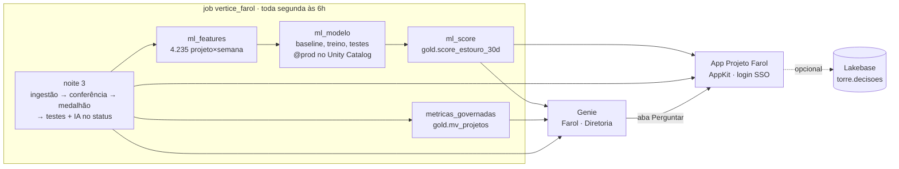
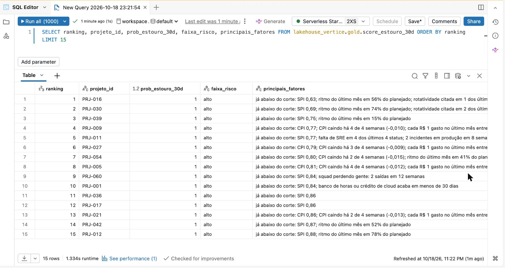
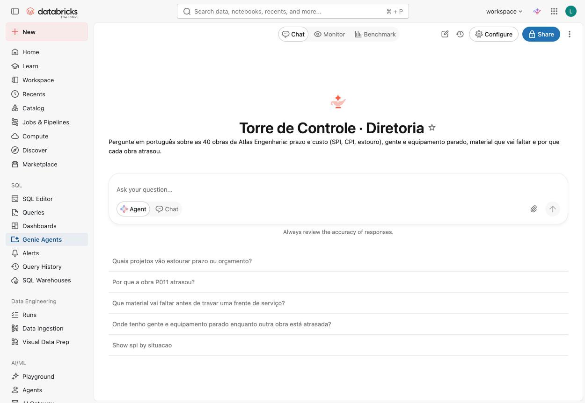
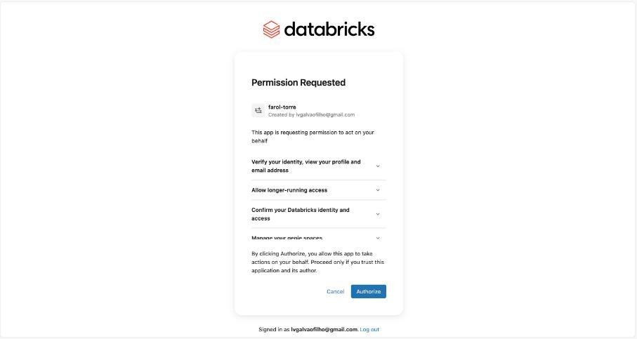
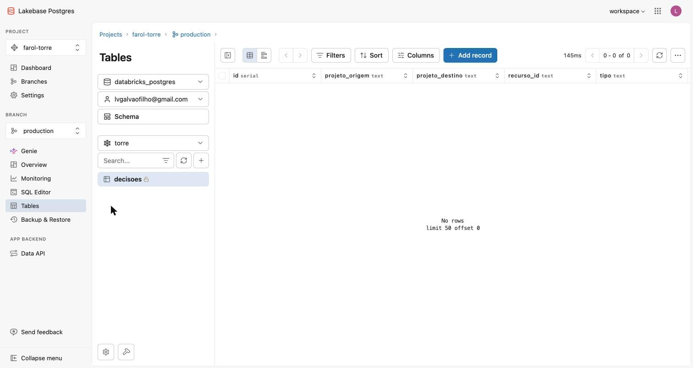

# 🔮 Noite 4 · Cientista de Dados e Engenheiro de IA | Imersão Databricks + Claude Code

> **Quinta, 22/10, 19h30** · 📺 gravação: _link após a live_
>
> **Pergunta da noite:** *"O que vai dar errado no próximo mês? E o dono, que não escreve SQL?"*
> **Formato:** 3 prompts no Claude Code (mais 1 opcional), no mesmo bundle da noite 3, e o pitch.

## O que você terá ao fim da noite

1. **Um modelo que avisa antes.** Toda segunda às 6h, a lista dos 41 projetos em andamento com a
   **chance de cada um estourar nos próximos 30 dias** e o **motivo em português**.
2. **Um Genie que acerta as 4 perguntas do dono**, em português, com a fórmula de cada KPI num lugar só.
3. **O app do Projeto Farol**: uma URL que o dono abre no celular, com o login do workspace.
4. *(opcional)* **Um botão Aprovar** que grava a decisão num banco (Lakebase), com o seu e-mail e o horário.
5. **O pitch de 3 minutos** para pedir o piloto ao dono ([`pitch.md`](pitch.md)).

**Por que isso fecha a história.** A noite 3 deixou a Torre rodando sozinha, com um dashboard. Mas ela
só sabe dizer quem **já** estourou, e as respostas ainda moram em tabelas que o dono não abre. Hoje a Torre
passa a **prever**, a **conversar** e a ter **endereço**.

| Noite | O que ficou de pé | O papel |
|---|---|---|
| 1 | as 3 ferramentas no catálogo, SPI e CPI à mão, dashboard e Genie sobre a bronze | analista |
| 2 | a ingestão: data lake (S3/boto3) e API, num job | engenheiro |
| 3 | o job como código: silver, gold, testes, IA no status, dashboard | engenheiro com Claude Code |
| **4** | **o modelo, o Genie curado e o app** | **cientista e engenheiro de IA** |

| Pergunta do dono | Onde a noite 4 responde |
|---|---|
| Quais projetos estão atrasados, e de quais clientes? | Genie + app → **Projetos em risco** |
| Quanto esse atraso vai me custar? | Genie (`mv_projetos`) + app (estouro previsto) |
| Tenho gente parada enquanto outro projeto pede gente? | Genie + app → **Simulador** (COL0017 → PRJ-011) |
| O que vai dar errado no próximo mês, e o que eu faço agora? | **o modelo** (prompt 1), lido pelo Genie e pelo app |

---

## 🎬 O caso da noite: PRJ-024, o projeto que "está ok"

A regra da Vértice é simples: **SPI ou CPI abaixo de 0,9 = atenção** (SPI mede o prazo, CPI mede o
custo; 1,0 é "no plano"). Para essa regra, o **PRJ-024 · Marketplace de sellers** está ok: SPI 0,91,
CPI 0,97.

No fim do prompt 1, o modelo vai dizer outra coisa:

> **PRJ-024 · 46% de chance de cruzar 0,9 em 30 dias.** Motivo: *"a 0,01 do corte de 0,9 (índice 0,91)"*.

E o calendário piora a conta: é o marketplace de um cliente de varejo. No freeze da Black Friday do ano
passado, o SPI dele caiu de **0,99 para 0,70**. O de 2026 começa em **01/11**, daqui a 15 dias, e trava
deploy. O modelo não sabe do calendário; o **Genie do prompt 2 junta os dois**. E o **app do prompt 3**
põe os 46% na frente do dono, ao lado do simulador que move uma SRE parada para o PRJ-011.

Guarde esse projeto: é ele que a gente persegue a noite toda.

---

## 📖 As palavras novas da noite

| Termo | Em uma frase |
|---|---|
| **Rótulo** | a resposta que queremos prever: *"nas 4 semanas seguintes, o projeto caiu abaixo de 0,9?"* (1 = sim, 0 = não). |
| **Feature** | um sinal que o modelo olha para dar o palpite: o SPI de hoje, quanto ele caiu no mês, quantas pessoas saíram do time. |
| **Corte no tempo** | o modelo aprende com o passado (até 06/03/2026) e é cobrado no futuro (de 03/04/2026 em diante), como na vida real. |
| **Vazamento** | quando uma feature, sem querer, já sabe o futuro. O modelo fica brilhante no teste e inútil na segunda-feira. |
| **Baseline** | a regra simples que qualquer um usaria. O modelo só entra se ganhar dela. |
| **AUC** | uma nota de 0,5 a 1: 0,5 é jogar moeda, 1,0 é acertar sempre a ordem "quem estoura antes de quem não estoura". |
| **MLflow e `@prod`** | o caderno de laboratório do modelo; no Unity Catalog o modelo vira um objeto do catálogo, e `@prod` aponta para a versão em uso. |
| **Metric view** | uma view do Unity Catalog que guarda a **fórmula** do KPI (`MEASURE(spi)`), não o número. |
| **Genie (Genie Agent)** | o "chat com os dados" do Databricks: você pergunta em português, ele escreve o SQL nas tabelas que você liberou e responde. Dá para ver o SQL de cada resposta. |
| **Databricks App** | um site que roda dentro do Databricks, com o login da empresa. Ninguém precisa de senha nova. |
| **Service principal** | o "usuário robô" do app. Ele nasce sem acesso a nada: você dá as permissões com `GRANT`. |
| **OAuth "Authorize"** | no primeiro acesso, o app pede licença para agir em seu nome (perguntar ao Genie como você). Cada pessoa clica **Authorize** uma vez. |
| **Lakebase** | um banco **Postgres** gerenciado pelo Databricks, feito para gravar uma linha por clique, na hora. |

---

## 🏛️ Arquitetura



Leia assim: **o job ganha mais quatro tarefas** (o modelo e a metric view), **o Genie lê tudo o que
o job grava**, e **o app mostra, conversa e (opcional) grava**. A leitura vai ao SQL warehouse (a
gold); a escrita vai ao Lakebase (o Postgres).

**Onde fica cada coisa:** o laboratório do cientista (features, métricas, modelo) mora no schema
`lakehouse_vertice.ml`. Na `gold` entram só o resultado (`score_estouro_30d`) e a metric view.

---

## 🛠️ Passo a passo

### 0. Antes de começar (5 min)

- A noite 3 rodada: o bundle `vertice` na raiz do seu repositório `projeto-farol`, e o job
  `vertice_farol` verde (gold, `status_estruturado` e o dashboard).
- CLI do Databricks (`databricks -v` ≥ 0.250), Node 22+ (para o app) e Claude Code.
- Login: `databricks auth login --profile <perfil>`.
- **O Free Edition aceita no máximo 3 apps.** Rode `databricks apps list --profile <perfil>`; se já houver
  três, apague um que você não usa mais.
- Baixe o contexto da noite e as ferramentas do Genie para o seu repositório (na raiz do `projeto-farol`):

```bash
B=https://raw.githubusercontent.com/lvgalvao/ImersaoControlTower/main
mkdir -p aulas/aula-04-produtos-de-dados-ia/prd scripts
curl -fsSL -o aulas/aula-04-produtos-de-dados-ia/prd/CLAUDE.md $B/aulas/aula-04-produtos-de-dados-ia/prd/CLAUDE.md
curl -fsSL -o aulas/aula-04-produtos-de-dados-ia/prd/genie-benchmark-diretoria.json $B/aulas/aula-04-produtos-de-dados-ia/prd/genie-benchmark-diretoria.json
curl -fsSL -o scripts/genie.py $B/scripts/genie.py
```

**Como usar os prompts.** Abra o arquivo do prompt, copie o bloco da seção **"O prompt"** e cole no
Claude Code, na raiz do seu repositório, trocando `<perfil>` pelo seu.

| # | Entrega | Deploy | Arquivo |
|---|---|---|---|
| 1 | **O modelo**: features → modelo → score, 3 tarefas novas do job | `bundle deploy` + `run` | [`prd/prompt-01-modelo.md`](prd/prompt-01-modelo.md) |
| 2 | **Métricas + Genie**: `mv_projetos` e o Genie "Farol · Diretoria", com benchmark | `bundle deploy` | [`prd/prompt-02-genie.md`](prd/prompt-02-genie.md) |
| 3 | **O app da Torre**: projetos em risco (com o score), simulador, perguntar | `apps deploy` | [`prd/prompt-03-app.md`](prd/prompt-03-app.md) |
| 4 | *(opcional)* **A aprovação no Lakebase** e a tela Decisões | `apps deploy` | [`prd/prompt-04-aprovacao-lakebase.md`](prd/prompt-04-aprovacao-lakebase.md) |

### 1. Prompt 1 · o modelo (25 min)

**O problema.** A regra de corte acende quando o projeto **já** estourou. O dono quer saber 30 dias antes.

**O que o Claude Code faz:**

1. `ml_features` (SQL): uma linha por projeto e sexta-feira, **só olhando para trás**, com o rótulo
   (o pior índice das 4 semanas seguintes ficou abaixo de 0,9?). 4.235 linhas, taxa base de **16,7%**.
2. `ml_modelo` (notebook): imprime os **baselines** antes de treinar, treina com **corte no tempo**, e só
   registra o modelo no Unity Catalog (`@prod`) se passar em 4 testes: ganha da regra, AUC ≥ 0,75,
   AUC < 0,98 (senão é vazamento), avisa ≥ 70% dos estouros.
3. `ml_score` (notebook): a lista de segunda-feira, `gold.score_estouro_30d`, com probabilidade, faixa
   e os motivos em português.

**A conversa é sobre as decisões, não o código:**

| Decisão | Por quê |
|---|---|
| projeto × semana, não projeto | com 60 projetos não existe ML; com 4.235 sextas-feiras, existe |
| feature só olha para trás | senão o modelo "cola" do futuro |
| corte no tempo, não aleatório | é assim que ele vai ser usado: treinado no passado, cobrado no futuro |
| o baseline primeiro | a regra "quem está mais perto do corte" já faz **0,87**. O modelo faz **0,92** |
| a métrica do dono | **9 de 10** estouros no top 5 da semana, em média **41 dias antes** |



*`gold.score_estouro_30d`: os 17 projetos que a regra já vê aparecem com 1,0; logo abaixo, os que a regra
diz "ok" e o modelo não. Repare na coluna dos motivos, em português.*

### 2. Prompt 2 · métricas e Genie (20 min)

**O problema.** Na segunda, o Genie da noite 1 errou as 4 perguntas ("nenhum atraso custa nada"). E o
CPI do mesmo projeto tinha três valores, dependendo de quem calculou.

**O que o Claude Code faz:**

1. A metric view `gold.mv_projetos`: SPI, CPI, estouro, margem, projetos em risco, melancias, como
   **fórmula** (`MEASURE(spi)` é sempre `SUM(ev)/SUM(pv)`, no grão que a pergunta pedir).
2. O Genie **"Farol · Diretoria"** como recurso do bundle: as tabelas da gold, a metric view, o score, as
   instruções de negócio (o "hoje", as regras de corte, o que é "próximo mês") e exemplos de SQL.
3. O benchmark: 20 perguntas com a resposta certa em SQL. Abaixo de 16/20, ajusta a **instrução**.



*"Tenho gente parada enquanto outro projeto pede gente?": o Genie acha as duas SREs a ~5% no PRJ-007
enquanto o PRJ-011 está bloqueado por falta de SRE. (Print do ensaio de 18/10, antes do score.)*

### 3. Prompt 3 · o app da Torre (35 min)

**O problema.** O dono não abre SQL Editor. O Farol precisa de uma URL.

**O que o Claude Code faz:**

1. `databricks apps init` monta o esqueleto do app (React + TypeScript) em uns 10 segundos.
2. As leituras viram arquivos `.sql` em `config/queries/` (KPIs, projetos em risco, pessoas ociosas). O
   score vem por uma rota do servidor (se a tabela faltar, a tela mostra "—" em vez de quebrar o build).
3. Três telas: **Projetos em risco** (KPIs e a coluna P(estouro) do modelo), **Simulador** (pessoa ociosa
   → projeto que precisa) e **Perguntar** (o Genie do prompt 2 dentro do app).
4. `bundle deploy` cria o app e o **service principal**; `conceder-acesso.sh` dá a ele os `GRANT` na gold;
   `databricks apps deploy` publica o código.

> **Esperado:** sem os `GRANT`, o deploy falha com `INSUFFICIENT_PERMISSIONS`. Não é bug: é o robô sem
> permissão. Rode o `conceder-acesso.sh` e faça o deploy de novo.

> **Plano B (instrutor):** suba o gabarito antes da aula com
> `bash aulas/aula-04-produtos-de-dados-ia/torre-app/scripts/subir-tudo.sh <perfil>`. Se o deploy ao vivo
> travar, siga a aula pela URL do `farol-torre`.



*No primeiro acesso, "Permission Requested": o app pede para agir em seu nome. Repare em "Manage your
genie spaces": é o que deixa a aba Perguntar usar o Genie como você. Clique **Authorize** uma vez.*

**O simulador mostra a conta.** O dono não aprova caixa-preta. Para COL0017 → PRJ-011:

- **151 h** no mês (as horas paradas × 4 semanas);
- **R$ 30,1 mil** de ociosidade que deixa de ser paga;
- **19,0 dias** de cronograma recuperados (dias de impacto da falta de SRE nos últimos 90 dias ÷ 90 × 30);
- **R$ 8,0 mil** de onboarding (40 h × custo da hora);
- **saldo de R$ 22,1 mil** no mês.

Os 19 dias ficam fora da conta em R$: sem uma multa ou receita atrelada, dia de cronograma não vira dinheiro.

### 4. Prompt 4 (opcional) · a aprovação no Lakebase (12 min)

Entra se sobrar tempo. Se não sobrar, mostre o botão **Aprovar** no `farol-torre` (o gabarito já grava
no Lakebase) e deixe o prompt como lição de casa.

**O problema.** Hoje, mover uma SRE de projeto é decidido por WhatsApp. Ninguém sabe quem aprovou,
quando e por quê. O app ganha os botões **Aprovar** e **Recusar**; cada clique grava uma linha no
Postgres com o **e-mail de quem clicou** e o horário, e a tela **Decisões** mostra o histórico.



*Em **Tables**, schema `torre`, a tabela `decisoes`: antes do primeiro clique em Aprovar, "No rows";
depois dele, a linha aparece aqui.*

### 5. O pitch (10 min)

Três minutos, uma pergunta ao vivo, um número em reais. O roteiro, a tabela de ROI e as dicas estão em
[`pitch.md`](pitch.md). A demo é o caso da noite: o PRJ-024 com 46%, a pergunta do PRJ-011 e o simulador.

### Confira

```bash
python3 scripts/run_sql.py aulas/aula-04-produtos-de-dados-ia/99-verificacao.sql --profile <perfil>       # tudo ok
python3 scripts/genie.py benchmark "Farol · Diretoria" \
  aulas/aula-04-produtos-de-dados-ia/prd/genie-benchmark-diretoria.json --profile <perfil>               # ≥ 16/20
uv run --no-project --with "psycopg[binary]" python \
  aulas/aula-04-produtos-de-dados-ia/torre-app/scripts/ver_decisoes.py --profile <perfil>               # (prompt 4) a sua decisão
```

---

## 🔢 O que deve aparecer na tela

| O quê | Valor |
|---|---|
| `ml.features_projeto_semana` · treino · taxa base | 4.235 · 1.643 · 16,7% |
| Teste (a partir de 03/04/2026) | 580 projetos × semana, 70 terminaram o mês abaixo de 0,9 |
| AUC: regra da folga · classificador · **modelo** | 0,87 · 0,90 · **0,92** |
| Estouros avisados no top 5 · antecedência | **9 de 10** · **41 dias** |
| Score: alto · medio · baixo | 18 · 4 · 19 |
| Projetos "ok" para a regra com risco alto ou médio | 5 (entre eles PRJ-013, 0,89, e PRJ-024, 0,46) |
| Vazamento: corte no tempo · aleatório · com índice do futuro | 0,92 · 0,92 · **0,99** (barrado pelo teste de 0,98) |
| `mv_projetos`: SPI · CPI · estouro · críticos · melancias | 0,92 · 0,97 · R$ 6,47 mi · 7 · 4 |
| Benchmark do Genie "Farol · Diretoria" | 20/20 (18/10, antes do score); com o score: *a medir no ensaio* |
| App: em risco · críticos · melancias · estouro · alto risco em 30 dias | **17 de 41** · 7 · 4 · **R$ 6,5 mi** · 18 |
| Simulador COL0017 (PRJ-007) → PRJ-011 | 151 h no mês · R$ 30,1 mil de ociosidade evitada · **19,0 dias** recuperados · onboarding R$ 8,0 mil · saldo R$ 22,1 mil |
| *(opcional)* Aprovar COL0017 → PRJ-011 | "Decisão nº 1 aprovada e registrada por <seu e-mail>" |

Tudo com `random_state=42` e seed 42: rodando de novo, dá igual.

### A pergunta-âncora, o que o Genie deve responder

> *"O que vai dar errado no próximo mês?"* → os projetos "ok" com risco alto ou médio no modelo (entre
> eles o **PRJ-024, 46%**, a 0,01 do corte), as **5 entregas atrasadas da CodeForge** e o **freeze de 01/11**
> nos projetos de e-commerce, que pega o PRJ-024 de novo.

---

## ⏱️ Roteiro da noite (90 min)

| Bloco | Min | O quê |
|---|---:|---|
| Abertura | 5 | o arco das 4 noites; a pergunta 4; o PRJ-024 "ok" no quadro |
| Prompt 1 · o modelo | 25 | a sala propõe as regras simples; colar o prompt; as 5 decisões enquanto ele trabalha; o top 25 e o PRJ-024 |
| Prompt 2 · métricas + Genie | 20 | a mesma pergunta, três CPIs; o Genie da noite 1 errando; o novo acertando; o benchmark |
| Prompt 3 · o app | 30 | `apps list` (limite de 3), `apps init`, as queries, o GRANT ao vivo, o deploy, a URL, o simulador |
| Pitch | 10 | os 3 minutos, ao vivo, com a demo |

**Se atrasar:** o prompt 4 vira demonstração no `farol-torre`. Se o app travar, o plano B é o `farol-torre`
publicado antes da aula. Nunca corte o pitch.

---

## 🧯 Se der errado

| Sintoma | Causa | O que fazer |
|---|---|---|
| `s3:PutObject ... explicit deny` ao registrar o modelo | o serverless vem com MLflow 2.11 | `%pip install -U "mlflow-skinny[databricks]>=2.21,<3"` + `restartPython()` na 1ª célula |
| `AssertionError: perde da regra simples` | features erradas, ou o dado mudou | é o teste fazendo o trabalho dele: confira as features |
| `AssertionError: bom DEMAIS` | feature que vê o futuro | procure `FOLLOWING` fora das colunas `alvo_`/`estoura_` |
| `InvalidVersion: '18.x-aarch64-photon-scala2'` | `spark_udf` no serverless | `mlflow.sklearn.load_model` + pandas |
| `metricas_governadas` falha no job, mas roda no `run_sql.py` | `;` dentro do YAML da metric view | a `sql_task` corta em todo `;`: tire o `;` |
| Genie: `Table ... does not exist` no deploy | o Genie foi criado antes de a tabela existir | `bundle run vertice_farol` e deploy de novo |
| `reached the maximum limit of 3 apps` | o Free Edition aceita 3 apps | apague um app que não usa mais |
| `apps deploy`: `INSUFFICIENT_PERMISSIONS` | service principal sem GRANT | `bash scripts/conceder-acesso.sh <perfil> minha-torre` e deploy de novo |
| `Requested node type [UNKNOWN] is not supported` | arquivo `*.geniespace.json` dentro do app | nenhum JSON de Genie dentro da pasta do app |
| O deploy do `vertice` demora e sobe milhares de arquivos | o app está dentro da pasta do bundle | `sync: { exclude: ["minha-torre/**"] }` no `databricks.yml` da raiz |
| `permission denied for schema torre` | o schema foi criado por você no `npm run dev` | apague o schema `torre` e reinicie o app |
| `A soft-deleted project currently has this resource name` | apagou o Lakebase sem `--purge` | `databricks postgres delete-project projects/<id> --purge` |
| App pede "Permission Requested" | consentimento OAuth (o Genie age em seu nome) | **Authorize**, uma vez |
| Tela com números sem formato | o warehouse devolve número como string | `num()` / `Number()` |

Limpar para ensaiar de novo:

```bash
bash aulas/aula-04-produtos-de-dados-ia/prd/99-limpar-modelo.sh <perfil> [--apagar]   # só o modelo (prompt 1)
bash aulas/aula-04-produtos-de-dados-ia/prd/99-limpar-aula-04.sh <perfil> [--apagar]  # o app e o Lakebase
```

---

## 🗂️ Arquivos

| Arquivo | Para que serve |
|---|---|
| `prd/CLAUDE.md` | contexto que o Claude Code lê antes dos prompts (junto com o `CLAUDE.md` da noite 3) |
| `prd/prompt-0N-*.md` | os 4 prompts, com o que mostrar, o que falar e "se der errado" |
| `prd/genie-benchmark-diretoria.json` | 20 perguntas com SQL de referência |
| `prd/99-limpar-modelo.sh` · `prd/99-limpar-aula-04.sh` | apagam só o modelo, ou só o app e o Lakebase |
| `99-verificacao.sql` | modelo, metric view e os números do app, esperado × obtido |
| `notebooks/01-o-que-o-modelo-vale.sql` | conferência: métricas, lista de segunda e a curva do PRJ-024 |
| `notebooks/02-o-vazamento-de-dado.py` | o mesmo modelo em 3 divisões: honesta, aleatória e com vazamento |
| `torre-app/` | o gabarito do app (e o plano B) |
| `minha-torre/` | onde você constrói o seu app (na raiz do seu repositório) |
| `bonus/` | o agente que lê contrato (`ai_parse_document` + `ai_extract`), para fazer em casa |
| `pitch.md` | o pitch de 3 minutos e o checklist de publicação |
| `APRENDIZADOS.md` | o que falhou no ensaio e como foi resolvido |
| Gabarito do ML, das métricas e do Genie | [`../aula-03-modelagem-claude-code/claude-code/vertice/`](../aula-03-modelagem-claude-code/claude-code/vertice): `src/ml/`, `src/metricas/`, `scripts/gerar_genie.py` e as tarefas `ml_*` e `metricas_governadas` em `resources/vertice.job.yml` |
| Slides | [`slides/imersao.html`](../../slides/imersao.html), seção da noite 4 (abra no navegador, ← → navega, F tela cheia) |
